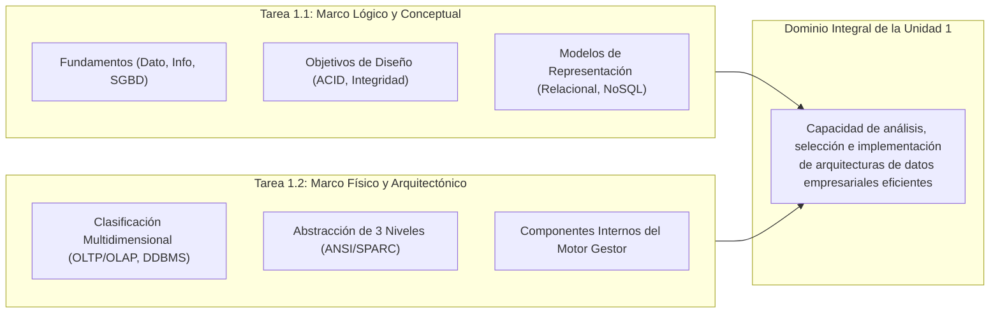

# Unidad 1: Introducción a las Bases de Datos

> **Tecnológico Nacional de México — Campus Monclova (ITSM)**  
> **Carrera:** Ingeniería en Sistemas Computacionales  
> **Materia:** Fundamentos de Bases de Datos  
> **Semestre:** 5° Semestre  
> **Docente:** Rubén Miguel Riojas  
> **Alumno:** Orlando Martínez Villarreal *(Matrícula: I24050386)*  
> **Competencia específica:** Conoce y comprende los conceptos básicos de base de datos para proponer soluciones en el tratamiento de información.

---

## 📌 Presentación de la Unidad

La **Unidad 1: Introducción a las bases de datos** establece los pilares teóricos, metodológicos y arquitectónicos necesarios para comprender cómo se organiza, gestiona y procesa la información en los entornos informáticos modernos. Se analiza la transición crítica desde los sistemas de archivos tradicionales hacia los **Sistemas Gestores de Bases de Datos (SGBD / DBMS)**, abarcando desde las definiciones abstractas de datos y metadatos, hasta la taxonomía exhaustiva de modelos lógicos y el desglose de las arquitecturas estandarizadas de tres niveles (ANSI/SPARC) y funcionales internas del motor gestor.

Este directorio centraliza las actividades académicas desarrolladas para la unidad, organizadas de forma modular con su respectiva documentación técnica, recursos gráficos vectoriales y de alta definición, documentos formales y referencias bibliográficas en formato APA 7ma edición.

---

## 📂 Estructura del Repositorio de la Unidad

```plaintext
Unidad1/
├── ACT.md                      # Descripción institucional de instrucciones y actividades
├── README.md                   # Índice general y documentación de la Unidad 1 (este archivo)
│
├── Tarea1.1/                   # Tarea 1.1: Fundamentos, Objetivos y Modelos de BD
│   ├── README.md               # Documentación teórica, mapa conceptual y tabla comparativa
│   ├── Tarea1.1.pdf            # Documento formal con portada y desarrollo académico
│   ├── mapa_conceptual.png     # Render de alta resolución (6667x2362 px)
│   ├── mapa_conceptual.svg     # Archivo fuente vectorial editable del mapa conceptual
│   ├── tabla_comparativa.png   # Render de alta resolución (5945x4634 px)
│   └── tabla_comparativa.svg   # Archivo fuente vectorial editable de la tabla de modelos
│
└── Tarea1.2/                   # Tarea 1.2: Clasificación y Arquitecturas (ANSI/SPARC y SGBD)
    ├── README.md               # Documentación teórica, cuadro sinóptico y arquitecturas
    ├── Tarea1.2.pdf           # Documento formal con portada institucional (.pdf)
    ├── generar_diagramas.py    # Script de automatización para exportar diagramas SVG/PNG
    ├── cuadro_sinoptico.png    # Render de alta resolución del cuadro de clasificación
    ├── cuadro_sinoptico.svg    # Archivo fuente vectorial del cuadro sinóptico
    ├── arquitectura_ansisparc.png  # Diagrama de tres niveles de abstracción ANSI/SPARC
    ├── arquitectura_ansisparc.svg  # Archivo vectorial de la arquitectura ANSI/SPARC
    ├── arquitectura_sgbd.png   # Diagrama de módulos internos funcionales del SGBD
    └── arquitectura_sgbd.svg   # Archivo vectorial de la arquitectura interna del SGBD
```

---

## 📑 Resumen de Actividades

| Actividad | Tema Principal | Recursos Gráficos Clave | Documento Técnico | Documentación Detallada |
| :--- | :--- | :--- | :--- | :--- |
| **[Tarea 1.1](./Tarea1.1/README.md)** | Fundamentos, objetivos primordiales, áreas de aplicación y comparativa exhaustiva de modelos de datos. | • [Mapa Conceptual (PNG)](./Tarea1.1/mapa_conceptual.png)<br>• [Tabla Comparativa (PNG)](./Tarea1.1/tabla_comparativa.png) | 📄 [Tarea1.1.pdf](./Tarea1.1/Tarea1.1.pdf) | 📖 [README Tarea 1.1](./Tarea1.1/README.md) |
| **[Tarea 1.2](./Tarea1.2/README.md)** | Taxonomía de bases de datos, arquitectura de 3 niveles ANSI/SPARC y arquitectura funcional del SGBD. | • [Cuadro Sinóptico (PNG)](./Tarea1.2/cuadro_sinoptico.png)<br>• [ANSI/SPARC (PNG)](./Tarea1.2/arquitectura_ansisparc.png)<br>• [Motor SGBD (PNG)](./Tarea1.2/arquitectura_sgbd.png) | 📄 [Tarea1.2.pdf](./Tarea1.2/Tarea1.2.pdf) | 📖 [README Tarea 1.2](./Tarea1.2/README.md) |

---

## 1. 📘 Tarea 1.1: Fundamentos, Objetivos y Modelos de Bases de Datos

* **Ubicación:** [`./Tarea1.1/`](./Tarea1.1/README.md)  
* **Objetivo de la actividad:** Investigar y sintetizar los conceptos básicos de datos e información, los objetivos de diseño que justifican la adopción de un SGBD, su impacto transversal en diversos sectores industriales, y analizar comparativamente la evolución de los modelos de datos (desde los modelos clásicos en árbol y red hasta el paradigma relacional, orientado a objetos y la revolución NoSQL).

### Contenidos Clave Abordados:
1. **Fundamentos Conceptuales:**
   * **Dato:** Unidad atómica o valor simbólico elemental sin procesar.
   * **Información:** Conjunto ordenado de datos contextualizados con valor semántico para la toma de decisiones.
   * **Metadatos:** Datos que describen la estructura y restricciones de otros datos (catálogo o diccionario de datos).
   * **Base de Datos (BD):** Colección estructurada, integrada y compartida de datos lógicamente coherentes.
   * **SGBD (DBMS):** Software que media entre los usuarios/aplicaciones y los datos físicos, garantizando independencia e integridad.
2. **Objetivos de los Sistemas de Bases de Datos:**
   * Control y reducción drástica de la redundancia e inconsistencias.
   * Preservación de la integridad referencial, de entidad y restricciones de negocio.
   * Independencia lógica y física de datos respecto a los programas de software.
   * Seguridad granular, autenticación y autorización mediante privilegios y roles.
   * Soporte de concurrencia multiusuario bajo garantías **ACID** (Atomicidad, Consistencia, Aislamiento y Durabilidad).
   * Mecanismos automatizados de respaldo (*backup*) y recuperación tolerante a fallos (*recovery*).
3. **Modelos de Datos Comparados:**
   * **Jerárquico:** Estructura en árbol (1:N) con punteros rígidos de navegación (ej. IBM IMS).
   * **En Red (CODASYL):** Estructura en grafos y conjuntos *Owner-Member* con relaciones N:M directas (ej. IDMS).
   * **Relacional:** Tablas bidimensionales basadas en teoría de conjuntos, álgebra relacional y claves PK/FK con estándar SQL (ej. PostgreSQL, MySQL, Oracle, SQL Server).
   * **Orientado a Objetos (OODBMS):** Persistencia directa de clases, métodos, encapsulamiento y herencia eliminando la discrepancia de impedancia (ej. db4o, ObjectStore).
   * **Objeto-Relacional (ORDBMS):** Extensión del modelo relacional con soporte nativo de tipos de datos abstractos (UDT) y herencia (ej. PostgreSQL, Oracle).
   * **NoSQL Documental:** Documentos semiestructurados JSON/BSON con esquemas dinámicos (ej. MongoDB, Couchbase).
   * **NoSQL Clave-Valor:** Almacenes basados en tablas hash de latencia ultra baja (ej. Redis, DynamoDB).
   * **NoSQL Familias de Columnas:** Almacenamiento disperso optimizado para Big Data analítico (ej. Cassandra, HBase).
   * **NoSQL Grafos:** Modelado mediante nodos, aristas dirigidas y propiedades con adyacencia libre de índices (ej. Neo4j).

### Recursos Gráficos Destacados:
* 🖼️ **Mapa Conceptual Analítico:** Disponible en [mapa_conceptual.png](./Tarea1.1/mapa_conceptual.png).
* 📊 **Tabla Comparativa de Modelos:** Disponible en [tabla_comparativa.png](./Tarea1.1/tabla_comparativa.png).

---

## 2. 📗 Tarea 1.2: Clasificación y Arquitecturas (ANSI/SPARC y SGBD)

* **Ubicación:** [`./Tarea1.2/`](./Tarea1.2/README.md)  
* **Objetivo de la actividad:** Clasificar las bases de datos a partir de múltiples dimensiones taxonómicas (dinamismo, distribución, contenido y paradigma) y esquematizar con rigurosidad técnica los tres niveles de abstracción estandarizados por ANSI/SPARC junto con la arquitectura funcional de subsistemas que conforman el motor interno de un SGBD.

### Contenidos Clave Abordados:
1. **Taxonomía Integral de Bases de Datos:**
   * **Por su variabilidad (dinamismo):** Estáticas (OLAP / analíticas de solo lectura para BI) vs. Dinámicas (OLTP / transaccionales concurrentes en tiempo real).
   * **Por su distribución física y ubicación:** Centralizadas (un solo nodo), Distribuidas (DDBMS particionadas/replicadas), En la Nube (Cloud-Native / DBaaS elásticos) y Embebidas (integradas en el binario como SQLite).
   * **Por la naturaleza de su contenido:** Bibliográficas/Referenciales, Texto Completo (motores de búsqueda indexada invertida), Series Temporales (TSDB para telemetría e IoT), Geoespaciales (GIS con árboles R) y Directorios de Identidades (LDAP).
   * **Por el paradigma lógico:** Relacionales (RDBMS), No relacionales (NoSQL), Objeto-Relacionales (ORDBMS) y NewSQL (escalado horizontal masivo con garantías ACID estrictas).
2. **Arquitectura de Tres Niveles ANSI/SPARC:**
   * **Nivel Externo:** Vistas individuales adaptadas a cada rol o aplicación, ocultando datos no pertinentes o confidenciales.
   * **Nivel Conceptual:** Esquema unificado global que modela todas las entidades, relaciones y reglas de integridad de la organización.
   * **Nivel Interno (Físico):** Estructuración física de bajo nivel (páginas de memoria, distribución en bloques de disco, índices B+Tree/Hash y compresión).
   * **Mapeos e Independencia de Datos:**
     * *Mapeo Externo-Conceptual:* Concede **Independencia Lógica** (alterar tablas y atributos sin quebrar las vistas externas).
     * *Mapeo Conceptual-Interno:* Concede **Independencia Física** (reorganizar archivos, discos o índices sin alterar la estructura conceptual).
3. **Arquitectura Funcional Interna del SGBD:**
   * **Procesador de Consultas:** Parser sintáctico y semántico, Compilador DDL, Optimizador de Consultas basado en costos (CBO) y Motor de Ejecución (*Query Engine*).
   * **Gestor de Transacciones:** Control de Concurrencia (mecanismos 2PL, MVCC y detección de *deadlocks*), Bitácora Transaccional y Recuperación (protocolo WAL / algoritmo ARIES) y Mecanismos de Seguridad/Integridad.
   * **Gestor de Almacenamiento:** Administrador del *Buffer Pool* en memoria RAM (políticas LRU/Clock), Gestor de Métodos de Acceso a índices y Gestor de Archivos de Disco.
   * **Espacio de Persistencia en Disco:** Archivos de datos, catálogo del sistema (metadatos), archivos de índices y registros de bitácora transaccional (*WAL logs*).

### Recursos Gráficos Destacados:
* 🗂️ **Cuadro Sinóptico de Clasificación:** [cuadro_sinoptico.png](./Tarea1.2/cuadro_sinoptico.png)
* 🏛️ **Arquitectura de Tres Niveles ANSI/SPARC:** [arquitectura_ansisparc.png](./Tarea1.2/arquitectura_ansisparc.png)
* ⚙️ **Arquitectura Funcional Interna del SGBD:** [arquitectura_sgbd.png](./Tarea1.2/arquitectura_sgbd.png)
* 🐍 **Script de Automatización Python:** [generar_diagramas.py](./Tarea1.2/generar_diagramas.py)

---

## 🔄 Articulación Conceptual entre Tarea 1.1 y Tarea 1.2

La siguiente matriz ilustra cómo ambas actividades convergen para consolidar la competencia específica de la unidad:



* Mientras que la **Tarea 1.1** responde al *qué*, *por qué* y *cómo se modelan* lógicamente los datos en el mundo real, la **Tarea 1.2** responde al *cómo se clasifican las tecnologías disponibles* y *cómo opera la maquinaria arquitectónica interna* que hace posible la persistencia confiable, la optimización y la concurrencia en disco y memoria.

---

## 🛠️ Herramientas y Tecnologías Utilizadas

* **Notación y Modelado:** Markdown, sintaxis Mermaid para flujos y esquemas arquitectónicos.
* **Diseño Gráfico y Renderizado Vectorial:** Python, SVG nativo vectorizado y renderizado rasterizado de alta definición (PNG a 300+ DPI).
* **Documentación Académica:** Microsoft Word (.docx) formal con plantilla institucional ITSM y exportación a PDF.
* **Control de Versiones y Difusión:** Git / GitHub para el repositorio público institucional y YouTube para la sustentación audiovisual.

---

## 📚 Referencias Bibliográficas (Formato APA 7ma Edición)

* ANSI/X3/SPARC. (1975). *Interim Report: Study Group on Data Base Management Systems*. ACM SIGMOD Bulletin, 7(2), 1–140.
* Connolly, T. M., & Begg, C. E. (2015). *Database Systems: A Practical Approach to Design, Implementation, and Management* (6th ed.). Pearson.
* Date, C. J. (2004). *An Introduction to Database Systems* (8th ed.). Addison-Wesley.
* Elmasri, R., & Navathe, S. B. (2016). *Fundamentals of Database Systems* (7th ed.). Pearson.
* Hellerstein, J. M., Stonebraker, M., & Hamilton, J. (2007). *Architecture of a Database System*. Foundations and Trends in Databases, 1(2), 141–259. https://doi.org/10.1561/1900000002
* Sadalage, P. J., & Fowler, M. (2013). *NoSQL Distilled: A Brief Guide to the Emerging World of Polyglot Persistence*. Addison-Wesley.
* Silberschatz, A., Korth, H. F., & Sudarshan, S. (2020). *Database System Concepts* (7th ed.). McGraw-Hill Education.
