# Tarea 1.1: Fundamentos, Objetivos y Modelos de Bases de Datos

* **Institución:** Instituto Tecnológico Superior de Monclova (TecNM Campus Monclova)  
* **Alumno:** Orlando Martínez Villarreal (Matrícula: I24050386)  
* **Docente:** Rubén Miguel Riojas  
* **Materia:** Fundamentos de Bases de Datos  
* **Semestre:** 5  
* **Unidad:** 1 – Introducción a las bases de datos  
* **Competencia específica:** Conoce y comprende los conceptos básicos de base de datos para proponer soluciones en el tratamiento de información.

---

## 📦 Entregables de la Actividad

* 📑 **Documento en PDF:** [Tarea1.1.pdf](./Tarea1.1.pdf)
* 🖼️ **Imagen del Cuadro (Mapa Conceptual):** [mapa_conceptual.png](./mapa_conceptual.png)
* 🖼️ **Imagen de la Tabla Comparativa:** [tabla_comparativa.png](./tabla_comparativa.png)
* 🎥 **Video Explicativo en YouTube:** [Video en YouTube](ENLACE_AQUI) *(Enlace para agregar manualmente)*

---

## 1. Fundamentos Conceptuales y Objetivos de las Bases de Datos

### 1.1 Conceptos Fundamentales
* **Dato:** Representación simbólica mínima (numérica, alfabética, binaria) de un hecho objetivo, evento o entidad, carente de contexto e interpretación intrínseca por sí misma.
* **Información:** Conjunto de datos estructurados, contextualizados y procesados que poseen significado semántico y reducen la incertidumbre en la toma de decisiones.
* **Metadatos:** Datos que describen la estructura, restricciones, tipo y significado de los propios datos almacenados (esquema o catálogo del sistema).
* **Base de Datos (BD):** Colección organizada, estructurada, compartida e interrelacionada de datos lógicamente coherentes, modelada para representar aspectos del mundo real (minumundo o universo de discurso).
* **Sistema Gestor de Bases de Datos (SGBD / DBMS):** Conjunto integral de herramientas de software que permite definir, construir, manipular, consultar y proteger bases de datos, garantizando la independencia entre los datos y los programas de aplicación.

### 1.2 Objetivos Primordiales de un SGBD
1. **Reducción y control de la redundancia:** Centraliza la información evitando el almacenamiento de copias innecesarias, mitigando discrepancias y desperdicio de almacenamiento.
2. **Consistencia e integridad de los datos:** Asegura que los datos respeten reglas lógicas de negocio, restricciones de dominio, unicidad e integridad referencial en todo momento.
3. **Independencia de datos:**
   * *Independencia física:* Capacidad de modificar el esquema físico (almacenamiento en disco, índices) sin alterar el esquema conceptual ni las aplicaciones.
   * *Independencia lógica:* Capacidad de modificar el esquema conceptual (añadir o reestructurar entidades) sin modificar los programas ni las vistas de usuario existentes.
4. **Seguridad y control de acceso:** Mecanismos de autenticación y autorización granular mediante roles y privilegios para salvaguardar la confidencialidad de la información.
5. **Concurrencia y soporte transaccional (Propiedades ACID):** Gestión coordinada del acceso simultáneo de múltiples usuarios a la misma información, preservando la atomicidad, consistencia, aislamiento y durabilidad de las transacciones.
6. **Respaldo y recuperación (Backup & Recovery):** Protocolos automáticos para reconstruir el estado consistente de la base de datos tras anomalías físicas, lógicas o fallas de energía.

### 1.3 Usos y Áreas de Aplicación
* **Sector Financiero y Bancario:** Procesamiento masivo de transacciones en tiempo real (transferencias, cajeros automáticos, prevención de fraude).
* **Comercio Electrónico y Retail (E-commerce):** Catálogos de productos, inventarios distribuidos multitienda, carritos de compra y procesamiento de órdenes.
* **Sector Salud y Expedientes Clínicos:** Historial médico digital del paciente, citas médicas, trazabilidad de fármacos e interoperabilidad hospitalaria.
* **Telecomunicaciones y Redes:** Facturación de servicios, tarificación dinámica, registro de detalles de llamadas (CDR) y gestión de tráfico de red.
* **Redes Sociales y Plataformas de Streaming:** Redes de amigos/seguidores, recomendaciones algorítmicas, almacenamiento de contenido multimedia y mensajes instantáneos.
* **Sistemas de Información Empresarial (ERP y CRM):** Gestión integral de recursos humanos, contabilidad corporativa, compras, ventas y relaciones con clientes.
* **Big Data, Internet de las Cosas (IoT) y Sensores:** Telemetría industrial, ciudades inteligentes, análisis de series temporales y análisis predictivo.

---

## 2. Mapa Conceptual Analítico

El siguiente mapa conceptual ilustra la relación jerárquica y operativa entre los fundamentos, la administración mediante el SGBD, los objetivos de diseño, los modelos de representación lógica y los ámbitos de aplicación profesional:

```mermaid
flowchart TD
    %% Nodo Principal
    BD["Bases de Datos (BD)<br/>Colección estructurada e interrelacionada de datos"]

    %% Ramas Principales
    BD -->|"Se fundamentan en"| Fundamentos["Fundamentos Teóricos<br/>Conceptos esenciales de datos"]
    BD -->|"Son administradas mediante"| SGBD["SGBD / DBMS<br/>Software administrador del sistema"]
    BD -->|"Garantizan"| Objetivos["Objetivos de Diseño<br/>Propósitos y requerimientos clave"]
    BD -->|"Se estructuran mediante"| Modelos["Modelos de Datos<br/>Estructuración lógica de la info"]
    BD -->|"Se implementan en"| Aplicaciones["Áreas de Aplicación<br/>Sectores y casos de uso real"]

    %% Fundamentos
    Fundamentos --> D1["Dato<br/>Hecho elemental objetivo sin procesar"]
    Fundamentos --> D2["Información<br/>Datos procesados con contexto y semántica"]
    Fundamentos --> D3["Metadatos<br/>Catálogo activo y descripción del esquema"]

    %% SGBD
    SGBD --> S1["Independencia de Datos<br/>Física (almacén) y Lógica (esquemas)"]
    SGBD --> S2["Optimizador de Consultas<br/>Ejecución eficiente y rápida de SQL"]
    SGBD --> S3["Gestor de Transacciones<br/>Concurrencia, bloqueos y bitácora ACID"]

    %% Objetivos
    Objetivos --> O1["Control de Redundancia<br/>Elimina duplicidad e inconsistencias"]
    Objetivos --> O2["Integridad de Datos<br/>Reglas lógicas, dominio, PK y FK"]
    Objetivos --> O3["Seguridad y ACID<br/>Control de privilegios y atomicidad"]
    Objetivos --> O4["Respaldo y Recuperación<br/>Tolerancia a fallos y restauración"]

    %% Modelos
    Modelos --> M1["Modelos Clásicos<br/>Jerárquico (Árbol 1:N) y Red (CODASYL N:M)"]
    Modelos --> M2["Modelo Relacional<br/>Tablas, tuplas, álgebra relacional y SQL"]
    Modelos --> M3["Modelos Avanzados<br/>Orientado a Objetos (OO) y Objeto-Relacional"]
    Modelos --> M4["Modelos NoSQL<br/>Documental, Clave-Valor, Columnar y Grafos"]

    %% Aplicaciones
    Aplicaciones --> A1["Transaccional (OLTP)<br/>Banca, E-commerce, Facturación y ERP"]
    Aplicaciones --> A2["Analítico (OLAP)<br/>Data Warehouse, Inteligencia de Negocios"]
    Aplicaciones --> A3["Tiempo Real e IoT<br/>Redes Sociales, Salud, Streaming y Sensores"]
```

---

## 3. Tabla Comparativa de Modelos de Bases de Datos

A continuación se detalla el análisis comparativo entre los modelos de datos clásicos, relacionales, híbridos y no relacionales (NoSQL), evaluando su arquitectura interna, formalismo lógico, fortalezas, restricciones y gestores representativos:

| Modelo de Base de Datos | Época y Creador(es) Clave | Definición Conceptual | Forma de Representación de Datos | Manejo de Relaciones y Cardinalidad | Lenguaje / Interfaz de Acceso | Ventajas Clave | Desventajas / Limitaciones | SGBD Representativos |
| :--- | :--- | :--- | :--- | :--- | :--- | :--- | :--- | :--- |
| **Jerárquico** | Años 60 (IBM / North American Aviation) | Organiza los datos en una estructura arborescente estrictamente jerarquizada de registros padre e hijos. | Estructura en árbol (*Tree*): registros ordenados con nodos raíz, ramas y hojas unidos por punteros físicos. | Exclusivamente **1:N** (un hijo solo tiene un único padre). Las relaciones **N:M** requieren duplicar nodos o enlaces complejos. | Lenguajes procedimentales de navegación bajo nivel (DL/I). | • Alta velocidad de lectura secuencial. • Integridad automática padre-hijo. • Eficiente para jerarquías naturales. | • Rigidez estructural extrema. • Imposibilidad de representar relaciones N:M naturales sin redundancia. • Mantenimiento complejo de punteros. | IBM IMS (Information Management System). |
| **En Red (Network / CODASYL)** | 1969 (Charles Bachman / Conferencia CODASYL) | Extensión del modelo jerárquico que permite estructuras de grafo generalizadas donde un registro subordinado puede tener múltiples dueños. | Grafos de conjuntos (*Sets* de registros): conformados por registros *Owner* (propietario) y registros *Member* (miembro) vinculados por punteros directos. | Admite de forma nativa relaciones **1:N** y **N:M** mediante registros de interconexión (*junction records*). | Lenguajes procedimentales basados en cursores y comandos de navegación de punteros (DML CODASYL). | • Mayor flexibilidad que el modelo jerárquico. • Reducción de redundancia en relaciones complejas. • Acceso rápido por enlaces físicos. | • Extrema complejidad en el diseño del esquema. • Pobre independencia de datos; cambios en la estructura física rompen los programas. | IDMS (Cullinet), IDS (General Electric), TurboIMAGE. |
| **Relacional** | 1970 (Edgar Frank Codd / IBM) | Modelo fundamentado en la teoría matemática de conjuntos y la lógica de predicados de primer orden; concibe los datos como relaciones compuestas por tuplas. | **Tablas bidimensionales (Relaciones):** filas representan tuplas (instancias) y columnas representan atributos con dominios atómicos (1FN). | Basado en valores lógicos mediante **Claves Primarias (PK)** y **Claves Foráneas (FK)**. Soporta **1:1**, **1:N** y **N:M** (esta última mediante tabla intermedia). | Lenguajes declarativos no procedimentales basados en Álgebra Relacional (estándar universal: **SQL**). | • Completa independencia física y lógica de datos. • Estructura intuitiva y flexible. • Consistencia estricta (ACID) e integridad declarativa. • Estándar global de la industria. | • Menor eficiencia en consultas recursivas y jerárquicas profundas. • Escalabilidad horizontal (sharding) compleja de configurar. • Impedancia objeto-relacional al mapear con código OO. | PostgreSQL, MySQL, Oracle Database, Microsoft SQL Server, SQLite, MariaDB. |
| **Orientado a Objetos (OODBMS)** | Finales de los 80 (Grupo ODMG: Cattell, Bancilhon, etc.) | Integra de forma nativa los principios del paradigma de programación orientada a objetos (POO) con las capacidades de persistencia y concurrencia de una base de datos. | **Objetos encapsulados:** integran estado (atributos) y comportamiento (métodos). Incluye identificador de objeto único e inmutable (OID). | Manejo directo mediante referencias entre objetos (punteros lógicos), colecciones y jerarquías de herencia (generalización/especialización). | Lenguajes de consulta orientados a objetos como **OQL** (*Object Query Language*) o APIs integradas en Java/C++. | • Elimina por completo la discrepancia de impedancia (*impedance mismatch*). • Capacidad nativa para tipos de datos complejos y multimedia. • Soporte de polimorfismo y herencia. | • Falta de un estándar unificado consolidado al nivel de SQL. • Mecanismos de optimización de consultas menos maduros que en RDBMS. • Curva de aprendizaje técnica alta. | db4o, ObjectStore, Versant, Objectivity/DB. |
| **Objeto-Relacional (ORDBMS)** | Mediados de los 90 (Michael Stonebraker / Extensión SQL:1999) | Extensión evolutiva del modelo relacional clásico que incorpora conceptos orientados a objetos manteniendo la compatibilidad con SQL y las relaciones tabulares. | Tablas relacionales con soporte de **Tipos de Datos Abstractos (UDTs)**, tipos estructurados, herencia de tablas y funciones/métodos definidos por el usuario en el motor. | Combina claves foráneas lógicas clásicas con identificadores de referencia de objetos (`REF`) y tablas hijas por herencia. | SQL extendido (**SQL:1999**, SQL:2003 y posteriores) con extensiones procedurales (PL/SQL, PL/pgSQL). | • Preserva la compatibilidad total con sistemas relacionales y SQL. • Modela datos complejos (geoespaciales, series temporales, JSON nativo). • Alta robustez y escalabilidad corporativa. | • Mayor complejidad en el motor del SGBD. • El estándar SQL para tipos complejos varía entre proveedores de software. | PostgreSQL, Oracle Database, IBM Db2, Informix. |
| **NoSQL: Documental** | Finales de los 2000 (10gen / MongoDB Inc., Couchbase) | Almacena y recupera datos en forma de documentos auto-descriptivos y semiestructurados, prescindiendo del esquema estricto relacional (*schema-free* o *schema-on-read*). | **Documentos jerárquicos** codificados comúnmente en formato **JSON, BSON o XML**, agrupados en colecciones lógicas. | Se modela mediante **incrustación (*embedding*)** para relaciones 1:1 y 1:N jerárquicas, o mediante **referencias** para relaciones N:M. | APIs de consulta específicas mediante JSON (p. ej., MQL en MongoDB), MapReduce o dialectos SQL (N1QL en Couchbase). | • Esquema altamente flexible y dinámico. • Rápido desarrollo evolutivo. • Diseñado para escalabilidad horizontal nativa (*clustering / sharding*). • Mapeo directo con objetos JSON de aplicaciones web/móviles. | • Menor soporte nativo de integridad referencial automática. • Las operaciones de unión (*Joins*) entre colecciones son limitadas o costosas computacionalmente. • Posible redundancia masiva por desnormalización. | MongoDB, CouchDB, Couchbase, Amazon DocumentDB. |
| **NoSQL: Clave-Valor (Key-Value)** | Años 2000 (Amazon Dynamo Paper / Salvatore Sanfilippo) | Modelo de datos más simple y veloz: asocia una clave única e indexada a un valor opaco o estructurado, optimizado para operaciones de lectura/escritura atómicas. | Tabla de dispersión (*Hash Map* distribuido): tuplas de tipo `[Key -> Value]`, donde el valor puede ser cadenas, listas, hashes, sets o blobs binarios. | No existe concepto nativo de relaciones ni claves foráneas. Las asociaciones deben resolverse a nivel de aplicación cliente. | Comandos básicos de acceso por clave: `GET`, `SET`, `DEL`, o APIs REST/gRPC. | • Latencias ínfimas de lectura y escritura (sub-milisegundo en memoria RAM). • Escalabilidad horizontal masiva sin cuellos de botella. • Simplicidad operativa óptima para caché y sesiones. | • Imposibilidad de realizar consultas complejas basadas en los atributos del valor sin conocer la clave. • Sin soporte de transacciones complejas entre múltiples claves independientes. | Redis, AWS DynamoDB, Memcached, Riak. |
| **NoSQL: Familias de Columnas (Wide-Column)** | 2006 (Google Bigtable / Apache Cassandra) | Estructura inspirada en Google Bigtable: organiza los datos por columnas en lugar de filas, optimizando consultas masivas sobre grandes volúmenes de datos dispersos. | **Matriz multidimensional dispersa:** Filas con claves primarias (*Row Key*), familias de columnas (*Column Families*) y celdas versionadas por marcas de tiempo (*Timestamp*). | Basado en el particionamiento de filas mediante la clave de partición (*Partition Key*). No admite *Joins* ni claves foráneas. | Dialectos declarativos propios similares a SQL (p. ej. **CQL** en Cassandra) o APIs específicas del motor. | • Escalabilidad masiva para Petabytes de datos. • Excelente rendimiento de escritura secuencial. • Alta tolerancia a fallos sin punto único de falla (arquitectura *masterless*). | • Patrones de consulta rígidos; el esquema debe diseñarse en función exacta de las consultas requeridas. • Ineficiente para transacciones relacionales interconectadas. | Apache Cassandra, Google Bigtable, Apache HBase, ScyllaDB. |
| **NoSQL: Grafos (Graph Databases)** | Años 2000 (Neo4j / Emil Eifrem) | Aplica directamente la teoría matemática de grafos, modelando la información donde las relaciones son entidades de primer nivel (*first-class citizens*). | **Grafo de Propiedades (Property Graph):** Nodos (entidades), Aristas (*Edges* / Relaciones dirigidas tipadas) y Propiedades (atributos clave-valor en nodos y relaciones). | Las relaciones son directas y físicas mediante punteros en memoria (*Index-Free Adjacency*); soporta relaciones complejas **N:M** con propiedades asociadas. | Lenguajes declarativos de navegación en grafos como **Cypher** (Neo4j), Gremlin (Apache TinkerPop) o SPARQL (RDF). | • Desempeño constante en navegación y recorridos profundos de relaciones complejas (*traversals*). • Modelo natural e intuitivo para redes complejas e interconectadas. | • Complejidad para particionar y fragmentar grafos sobre múltiples servidores (escalabilidad horizontal difícil). • Inadecuado para procesamiento masivo de agregaciones tabulares simples. | Neo4j, Amazon Neptune, ArangoDB, TigerGraph. |

---

## 4. Análisis Crítico y Criterios de Selección de Modelos

El auge de la persistencia políglota (*Polyglot Persistence*) demuestra que no existe un modelo de base de datos universalmente superior:
* **El Modelo Relacional y Objeto-Relacional** continúa siendo la columna vertebral de los sistemas empresariales críticos que demandan consistencia transaccional absoluta (ACID), como la banca, nóminas y registros contables.
* **Los Modelos NoSQL Documental y Clave-Valor** son ideales cuando predomina la alta variabilidad en el esquema, el desarrollo ágil y la necesidad de escalar horizontalmente con latencias reducidas en entornos web y móviles.
* **El Modelo de Familias de Columnas** domina la analítica de Big Data y series temporales con millones de escrituras por segundo.
* **El Modelo de Grafos** sobresale indiscutiblemente cuando el valor analítico reside en las conexiones entre las entidades (detección de fraudes financieros, motores de recomendación, análisis de redes sociales y grafos de conocimiento).

---

## 5. Referencias Bibliográficas (Formato APA 7ma Edición)

* Connolly, T. M., & Begg, C. E. (2015). *Database Systems: A Practical Approach to Design, Implementation, and Management* (6th ed.). Pearson.
* Date, C. J. (2004). *An Introduction to Database Systems* (8th ed.). Addison-Wesley.
* Elmasri, R., & Navathe, S. B. (2016). *Fundamentals of Database Systems* (7th ed.). Pearson.
* Sadalage, P. J., & Fowler, M. (2013). *NoSQL Distilled: A Brief Guide to the Emerging World of Polyglot Persistence*. Addison-Wesley.
* Silberschatz, A., Korth, H. F., & Sudarshan, S. (2020). *Database System Concepts* (7th ed.). McGraw-Hill Education.
