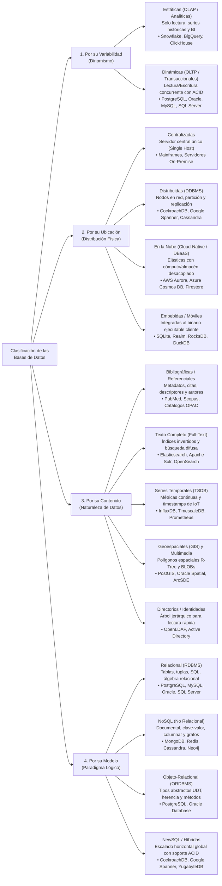
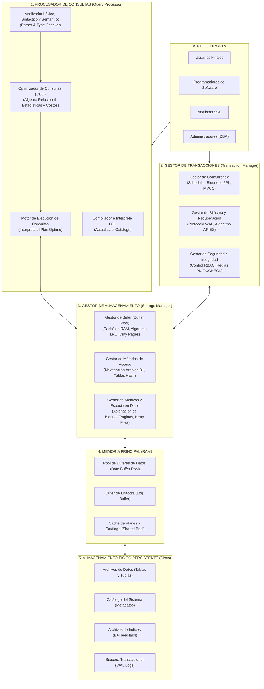

# Tarea 1.2: Clasificación y Arquitecturas (ANSI/SPARC y SGBD)

* **Institución:** Instituto Tecnológico Superior de Monclova (TecNM Campus Monclova)  
* **Alumno:** Orlando Martínez Villarreal (Matrícula: I24050386)  
* **Docente:** Rubén Miguel Riojas  
* **Materia:** Fundamentos de Bases de Datos  
* **Semestre:** 5  
* **Unidad:** 1 – Introducción a las bases de datos  
* **Competencia específica:** Conoce y comprende los conceptos básicos de base de datos para proponer soluciones en el tratamiento de información.

---

## 📦 Entregables de la Actividad

* 📑 **Documento Formal (.docx):** [Tarea1.2_Clasificacion_Arquitecturas_BD.docx](./Tarea1.2_Clasificacion_Arquitecturas_BD.docx)
* 🖼️ **Cuadro Sinóptico de Clasificación:** [cuadro_sinoptico.png](./cuadro_sinoptico.png) | [Vector SVG](./cuadro_sinoptico.svg)
* 🖼️ **Arquitectura de Tres Niveles ANSI/SPARC:** [arquitectura_ansisparc.png](./arquitectura_ansisparc.png) | [Vector SVG](./arquitectura_ansisparc.svg)
* 🖼️ **Arquitectura Funcional Interna del SGBD:** [arquitectura_sgbd.png](./arquitectura_sgbd.png) | [Vector SVG](./arquitectura_sgbd.svg)
* 🎥 **Video Explicativo en YouTube:** [Video en YouTube](ENLACE_AQUI) *(Enlace para agregar manualmente)*

---

## 1. Fundamentos: Clasificación y Arquitecturas de Bases de Datos

### 1.1 Criterios de Clasificación de Bases de Datos
* **Por su variabilidad o dinamismo:**
  * *Estáticas (OLAP):* Repositorios de solo lectura orientados al análisis histórico y Business Intelligence (Snowflake, BigQuery, ClickHouse).
  * *Dinámicas (OLTP):* Sistemas transaccionales de lectura/escritura en tiempo real con soporte ACID estricto (PostgreSQL, Oracle, MySQL, SQL Server).
* **Por su ubicación y distribución física:**
  * *Centralizadas:* Servidor central único; administración simple pero punto único de falla (SPOF).
  * *Distribuidas (DDBMS):* Múltiples nodos en red con fragmentación y replicación (CockroachDB, Spanner, Cassandra).
  * *En la Nube (Cloud-Native):* Servicios gestionados (DBaaS) elásticos con cómputo y almacenamiento desacoplados (AWS Aurora, Azure Cosmos DB).
  * *Embebidas y Móviles:* Motor integrado en la biblioteca del binario sin servidor independiente (SQLite, Realm).
* **Por el contenido y naturaleza de los datos:**
  * *Bibliográficas / Referenciales:* Metadatos, citas y resúmenes de documentos (PubMed, Scopus).
  * *Texto Completo (Full-Text):* Indexación invertida para recuperación léxica y difusa (Elasticsearch, Solr).
  * *Series Temporales (TSDB):* Secuencias numéricas indexadas por timestamps para telemetría e IoT (InfluxDB, TimescaleDB).
  * *Geoespaciales (GIS) y Multimedia:* Geometrías espaciales con árboles R y objetos binarios BLOBs (PostGIS, Oracle Spatial).
  * *Directorios / Identidades:* Árboles jerárquicos optimizados para alta lectura en autenticación (OpenLDAP, Active Directory).
* **Por el modelo y paradigma lógico:**
  * *Relacional (RDBMS):* Tablas, tuplas, álgebra relacional y estándar SQL (PostgreSQL, MySQL, SQL Server).
  * *NoSQL:* Esquemas flexibles; documental (MongoDB), clave-valor (Redis), columnar (Cassandra) y grafos (Neo4j).
  * *Objeto-Relacional (ORDBMS):* Extensión SQL con tipos abstractos (UDT) y herencia (PostgreSQL).
  * *NewSQL:* Escalabilidad horizontal masiva preservando garantías transaccionales ACID (CockroachDB, Spanner).

### 1.2 Arquitectura ANSI/SPARC y Niveles de Abstracción
* **Nivel Externo (Vistas de Usuario):** Múltiples esquemas que describen la parte de la BD relevante para cada grupo de usuarios, restringiendo accesos y simplificando la interacción.
* **Nivel Conceptual (Esquema Global):** Estructura lógica unificada de toda la organización (entidades, relaciones y restricciones de integridad), independiente de cómo se almacene físicamente.
* **Nivel Interno (Esquema Físico):** Estructuras físicas de bajo nivel: páginas de datos, punteros, compresión y métodos de acceso indexados (B+Tree, Hash).
* **Mapeos e Independencia de Datos:**
  * *Mapeo Externo-Conceptual:* Conecta vistas con el esquema conceptual, garantizando la **Independencia Lógica** (modificar tablas conceptuales sin romper vistas ni aplicaciones).
  * *Mapeo Conceptual-Interno:* Conecta entidades conceptuales con archivos físicos, garantizando la **Independencia Física** (cambiar discos, índices o particiones sin alterar el esquema conceptual).

### 1.3 Arquitectura Funcional Interna del SGBD
* **Procesador de Consultas:** Compilador DDL (escribe metadatos), Parser (valida sintaxis y semántica), Optimizador CBO (plan de ejecución óptimo basado en álgebra relacional y estadísticas) y Motor de Ejecución.
* **Gestor de Transacciones:** Control de Concurrencia (bloqueos 2PL y MVCC), Bitácora y Recuperación (protocolo WAL y algoritmo ARIES) y Control de Seguridad/Integridad.
* **Gestor de Almacenamiento:** Gestor de Búfer (Buffer Pool en RAM con reemplazo LRU), Gestor de Métodos de Acceso (árboles B+ y hashing) y Gestor de Archivos en Disco.
* **Persistencia Físico en Disco:** Archivos de datos, Catálogo del sistema (metadatos), Archivos de índices y Bitácora transaccional (WAL logs).

---

## 2. Cuadro Sinóptico de Clasificación de Bases de Datos

El siguiente cuadro sinóptico esquematiza la taxonomía completa de las bases de datos organizada por dinamismo, ubicación física, contenido temático y paradigma de modelado:

---

## 3. Esquema de Arquitectura de Tres Niveles ANSI/SPARC

El siguiente diagrama detalla la arquitectura de tres niveles de abstracción estandarizada por ANSI/SPARC, destacando los componentes de cada nivel y los mecanismos de mapeo que proporcionan independencia de datos:

```mermaid
flowchart TD
    subgraph Usuarios ["Capa de Usuarios y Aplicaciones"]
        U1["Usuarios Finales<br/>(Interfaces Web/Móvil)"]
        U2["Programadores de Software<br/>(DML / APIs / ORMs)"]
        U3["Administradores de BD<br/>(DBA / Herramientas DDL)"]
    end

    subgraph NivelExterno ["1. NIVEL EXTERNO (Esquemas Externos / Vistas de Usuario)"]
        V1["Esquema Externo 1<br/>Vista Ventas / Clientes"]
        V2["Esquema Externo 2<br/>Vista Nómina / RRHH"]
        V3["Esquema Externo n<br/>Vista Auditoría / BI"]
    end

    Bridge1["═══ MAPEO EXTERNO / CONCEPTUAL ═══<br/>✓ Garantiza INDEPENDENCIA LÓGICA DE DATOS<br/>(Modificaciones en el esquema conceptual no alteran las vistas de usuario ni el código cliente)"]

    subgraph NivelConceptual ["2. NIVEL CONCEPTUAL (Esquema Conceptual Global)"]
        C1["Esquema Conceptual Integral de la Organización<br/>• Entidades de negocio, Atributos y Dominios<br/>• Relaciones y Cardinalidades (1:1, 1:N, N:M)<br/>• Restricciones de Integridad (PK, FK, CHECK) y Reglas de Negocio"]
    end

    Bridge2["═══ MAPEO CONCEPTUAL / INTERNO ═══<br/>✓ Garantiza INDEPENDENCIA FÍSICA DE DATOS<br/>(Optimizaciones de índices, particiones o discos no alteran el esquema conceptual global)"]

    subgraph NivelInterno ["3. NIVEL INTERNO / FÍSICO (Esquema Interno)"]
        I1["Esquema Interno y Rutas de Acceso Físico<br/>• Asignación de páginas y bloques en disco (4KB/8KB)<br/>• Métodos de acceso indexados (Árboles B+, Tablas Hash)<br/>• Formato binario de tuplas, compresión, punteros y cifrado"]
    end

    subgraph Almacenamiento ["BASE DE DATOS FÍSICA (Persistencia no Volátil)"]
        D1[("Dispositivos de Almacenamiento Secundario<br/>Discos SSD NVMe, Arreglos RAID, Discos HDD<br/>Archivos de Datos (.mdf/.ibd), Índices, Metadatos y WAL")]
    end

    Usuarios --> NivelExterno
    NivelExterno <--> Bridge1
    Bridge1 <--> NivelConceptual
    NivelConceptual <--> Bridge2
    Bridge2 <--> NivelInterno
    NivelInterno <--> Almacenamiento
```

---

## 4. Esquema de Arquitectura Funcional Interna del SGBD

La arquitectura interna de un motor gestor de base de datos se estructura en módulos colaborativos que procesan las consultas, controlan la concurrencia, resguardan la durabilidad y gestionan la memoria y el almacenamiento persistente:

---

## 5. Análisis Crítico: Independencia de Datos y Flujo de Consultas

La interconexión entre la arquitectura abstracta ANSI/SPARC y la arquitectura funcional interna del SGBD se manifiesta en la ejecución de cada consulta:
* **Independencia de Datos Operativa:** Gracias a los mapeos, las aplicaciones no requieren modificaciones cuando el DBA añade índices B+Tree o reorganiza archivos en disco (independencia física), ni cuando se reestructuran tablas conceptuales sin alterar las vistas de usuario (independencia lógica).
* **Ciclo de Ejecución End-to-End:** 
  1. *Entrada:* La consulta SQL emitida desde una vista externa es validada gramatical y semánticamente por el *Parser* con apoyo del *Catálogo del Sistema*.
  2. *Optimización:* El *Optimizador (CBO)* evalúa planes de acceso mediante álgebra relacional y estadísticas de cardinalidad, seleccionando el plan de mínimo costo de I/O y CPU.
  3. *Transaccionalidad:* El *Gestor de Concurrencia* aplica bloqueos (2PL/MVCC) y el *Gestor de Bitácora* registra la operación en el *Log Buffer* siguiendo la regla WAL.
  4. *Almacenamiento y Buffer Pool:* El *Gestor de Búfer* comprueba si la página reside en la memoria RAM (*Buffer Pool*); ante un fallo de caché (*buffer miss*), solicita al *Gestor de Archivos* transferir el bloque desde disco SSD/HDD a memoria.
  5. *Persistencia:* La modificación se consolida en memoria (*dirty page*), el log se sincroniza a disco (*flush*) y la página se graba de forma diferida en el siguiente *checkpoint*.

---

## 6. Referencias Bibliográficas (Formato APA 7ma Edición)

* Connolly, T. M., & Begg, C. E. (2015). *Database Systems: A Practical Approach to Design, Implementation, and Management* (6th ed.). Pearson.
* Date, C. J. (2004). *An Introduction to Database Systems* (8th ed.). Addison-Wesley.
* Elmasri, R., & Navathe, S. B. (2016). *Fundamentals of Database Systems* (7th ed.). Pearson.
* Ramakrishnan, R., & Gehrke, J. (2003). *Database Management Systems* (3rd ed.). McGraw-Hill.
* Silberschatz, A., Korth, H. F., & Sudarshan, S. (2020). *Database System Concepts* (7th ed.). McGraw-Hill Education.
