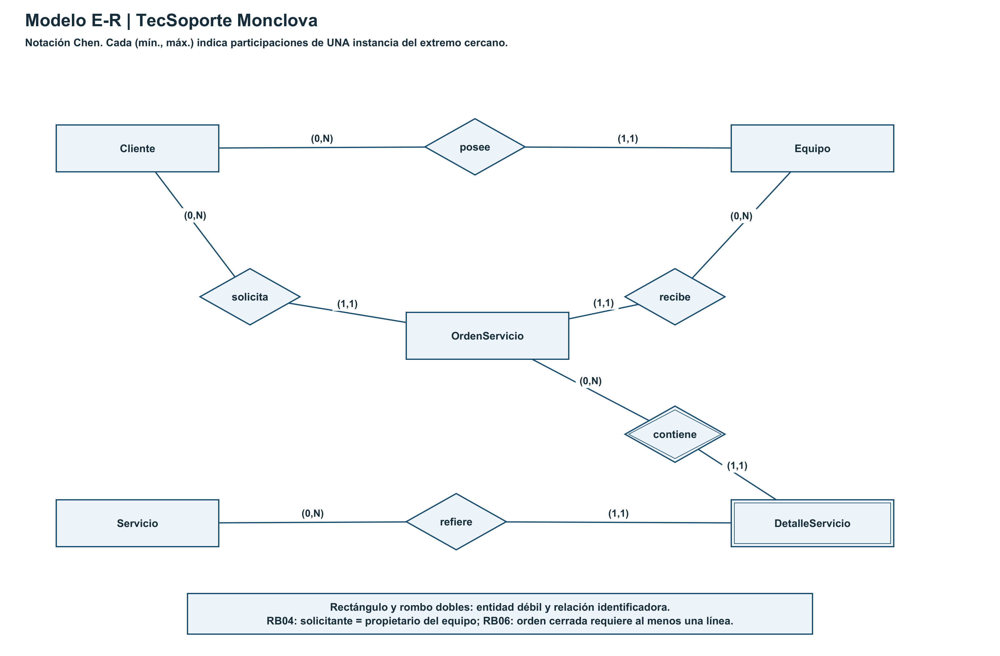
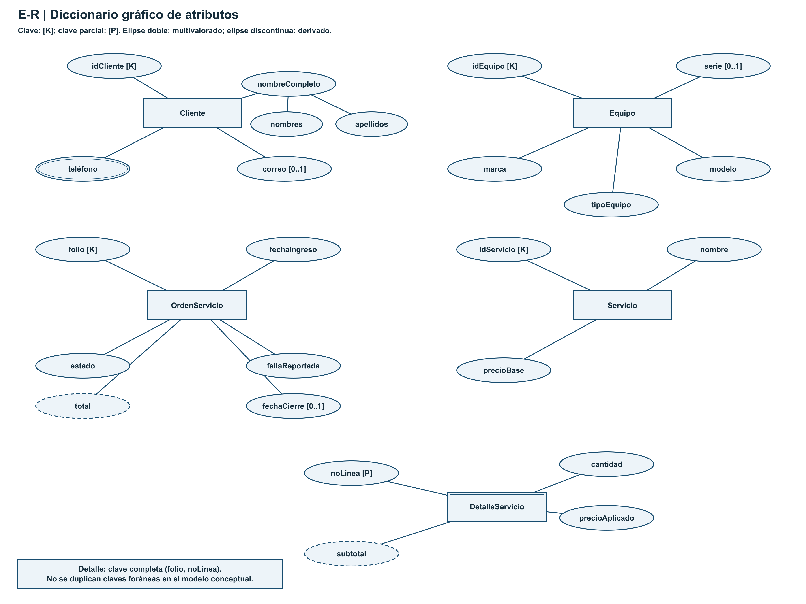
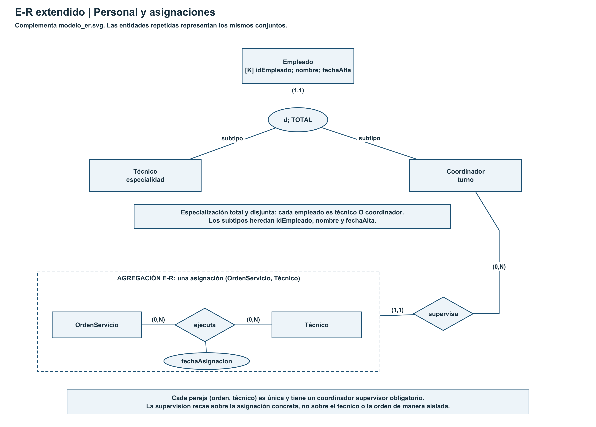

# Tarea 2.1: Modelado conceptual E-R y E-R extendido

- **Institución:** Instituto Tecnológico Superior de Monclova (TecNM Campus Monclova)  
- **Alumno:** Orlando Martínez Villarreal (Matrícula: I24050386)  
- **Docente:** Rubén Miguel Riojas  
- **Materia:** Fundamentos de Bases de Datos  
- **Semestre:** 5  
- **Unidad:** 2 – Diseño de Bases de Datos con el Modelo E-R  
- **Competencia específica:** Conoce y aplica el modelo E-R para el diseño conceptual de bases de datos con el fin de organizar la información y atender necesidades del entorno.

---

## 📦 Entregables de la Actividad

- 📑 **Documento en PDF** · [Tarea2.1.pdf](./Tarea2.1.pdf)
- 🖼️ **Modelo entidad–relación** · [PNG](./modelo_er.png)
- 🖼️ **Diccionario gráfico de atributos** · [PNG](./atributos_er.png)
- 🖼️ **Modelo E-R extendido** · [PNG](./modelo_eer.png)
- 🎥 **Video explicativo** · Grabación y publicación pendientes. [Guion y pendientes](./TODO.md).

---

## 1. Objetivo de la actividad

Diseñar un modelo conceptual que permita seguir la atención de computadoras desde la recepción del equipo hasta el cierre de la orden, preservando la identidad de los participantes y las restricciones del negocio.

## 2. Contextualización y planteamiento del problema

Un taller de soporte informático necesita distinguir al cliente, sus equipos y cada visita de servicio. Si todos esos datos se concentran en una libreta o una hoja de cálculo sin identificadores estables, dos equipos del mismo modelo pueden confundirse y resulta difícil responder quién solicitó una reparación, qué trabajos se cobraron y quién los realizó.

Se propone el caso académico **TecSoporte Monclova**, dedicado a mantenimiento preventivo, diagnóstico y reparación de computadoras. El nombre y los escenarios son ficticios; la problemática representa una actividad real del entorno, pero no se realizó una entrevista ni se dispone de registros de una empresa. Las reglas siguientes son supuestos explícitos que deberán validarse con un establecimiento antes de una implantación real.

El sistema debe registrar clientes y equipos, abrir órdenes de atención, seleccionar servicios del catálogo, conservar el precio aplicado en cada visita y relacionar los técnicos con las órdenes que atienden. Un coordinador supervisa cada asignación de trabajo. La solución permite recuperar el historial del equipo y calcular el importe de cada orden sin cambiar precios históricos cuando se actualiza el catálogo.

### Alcance y exclusiones

Se modelan recepción, servicios realizados y responsabilidad del personal. No se incluyen inventario de refacciones, facturación fiscal, pagos, garantías, autenticación ni transferencias de propiedad. Solo el propietario registrado puede solicitar una orden para su equipo. Se conserva el historial; la eliminación física de órdenes cerradas o personal referenciado queda fuera del flujo normal.

## 3. Reglas de negocio

| ID | Regla verificable |
| --- | --- |
| RB01 | Cada cliente tiene un idCliente único, nombre compuesto por nombres y apellidos, cero o más teléfonos distintos y un correo opcional. |
| RB02 | Cada equipo tiene idEquipo único y un solo propietario registrado. Un cliente puede tener cero o muchos equipos. La serie es opcional y no se utiliza como identificador universal. |
| RB03 | Una orden tiene folio único, fechaIngreso, fallaReportada y estado. Se refiere a un solo equipo y la solicita un solo cliente. Ambos pueden existir sin órdenes. |
| RB04 | El solicitante de una orden debe ser el propietario del equipo que recibe atención. No se permiten cambios de propietario dentro del alcance definido. |
| RB05 | Una orden puede abrirse sin servicios definidos. Cada DetalleServicio pertenece a una sola orden y se identifica por la pareja (folio, noLinea); noLinea es un entero positivo único dentro de esa orden. |
| RB06 | Una orden cerrada requiere por lo menos un detalle y una asignación de técnico. Una orden recibida o cancelada puede tener cero detalles o asignaciones. |
| RB07 | Cada detalle refiere exactamente un servicio del catálogo. Un servicio puede no haberse utilizado o aparecer en muchas líneas. Un mismo servicio puede repetirse en una orden con distinto noLinea. |
| RB08 | cantidad es un entero positivo; precioBase y precioAplicado son decimales no negativos en pesos mexicanos. precioAplicado conserva el precio acordado al registrar la línea y puede diferir de precioBase. |
| RB09 | subtotal = cantidad × precioAplicado; total de la orden = suma de sus subtotales, con valor cero si no hay líneas. Se usan decimales y redondeo monetario a dos decimales. |
| RB10 | Cada empleado tiene idEmpleado único, nombre y fechaAlta. Todo empleado es técnico o coordinador, sin pertenecer a ambos subtipos: especialización total y disjunta. |
| RB11 | Una orden puede ser atendida por varios técnicos, y un técnico puede atender varias órdenes. Cada pareja (orden, técnico) aparece una sola vez en ejecuta y tiene fechaAsignacion. |
| RB12 | Cada asignación orden-técnico tiene exactamente un coordinador supervisor. Un coordinador puede supervisar cero o muchas asignaciones. |
| RB13 | estado pertenece a {recibida, enProceso, cerrada, cancelada}. fechaCierre está presente si y solo si el estado es cerrada y no precede a fechaIngreso. fechaAsignacion no precede a fechaIngreso ni a fechaAlta del técnico. |
| RB14 | Órdenes y personal con historial se conservan. Cambiar el catálogo no altera el precioAplicado de detalles existentes. Las bajas operativas no deben borrar el historial. |

Las reglas RB04, RB06, RB09 y RB13 necesitan restricciones adicionales: una cardinalidad estática no puede representar por sí sola una condición dependiente del estado o una igualdad entre caminos del modelo.

## 4. Entidades y diccionario de datos

Se emplean nombres singulares. En el modelo conceptual las relaciones expresan las referencias; no se agregan claves foráneas como si ya se tratara de tablas SQL. Los tipos de la tabla son dominios propuestos para orientar la transición a UML.

| Entidad | Atributos y dominios | Identidad y observaciones |
| --- | --- | --- |
| Cliente | idCliente: entero positivo; nombreCompleto: compuesto (nombres, apellidos), texto no vacío; teléfono: conjunto de textos; correo: texto opcional | Clave idCliente; teléfono es multivalorado, no numérico, para conservar prefijos y ceros. No se usa el nombre como clave. |
| Equipo | idEquipo: entero positivo; serie: texto opcional; marca, modelo, tipoEquipo: textos no vacíos | Clave idEquipo. El dueño se representa mediante posee. serie no es clave candidata bajo estos supuestos. |
| OrdenServicio | folio: entero positivo; fechaIngreso: fecha/hora; fallaReportada: texto no vacío; estado: dominio enumerado; fechaCierre: fecha/hora opcional; total: decimal derivado | Clave folio. total no es un dato de captura y depende de los detalles vigentes de la orden. |
| Servicio | idServicio: entero positivo; nombre: texto no vacío; precioBase: decimal monetario no negativo | Clave idServicio. precioBase es la referencia actual del catálogo. |
| DetalleServicio | noLinea: entero positivo; cantidad: entero positivo; precioAplicado: decimal monetario no negativo; subtotal: decimal derivado | Entidad débil; clave parcial noLinea y clave completa (folio de la orden, noLinea). Depende de OrdenServicio. |
| Empleado | idEmpleado: entero positivo; nombre: texto no vacío; fechaAlta: fecha | Supertipo. Su clave se hereda a ambos subtipos; no se genera otra identidad en cada subtipo. |
| Técnico | especialidad: texto no vacío | Subtipo de Empleado. Hereda idEmpleado, nombre y fechaAlta. |
| Coordinador | turno: texto no vacío | Subtipo de Empleado. Hereda idEmpleado, nombre y fechaAlta. |
| ejecuta (relación) | fechaAsignacion: fecha/hora | Su identidad es la pareja (folio, idEmpleado del técnico); se agrega conceptualmente para recibir supervisión. |

### Clasificación de atributos

- **Claves simples:** idCliente, idEquipo, folio, idServicio e idEmpleado.
- **Clave parcial:** noLinea solo distingue detalles dentro de una orden; puede repetirse en otra.
- **Compuesto:** nombreCompleto = (nombres, apellidos) de Cliente. La separación se propone para búsquedas y presentación; no se exige un número fijo de apellidos.
- **Multivalorado:** teléfono de Cliente. Se permiten cero o más valores distintos. En un futuro esquema relacional requeriría una relación separada.
- **Derivados:** subtotal y total. Se calculan para evitar divergencias entre líneas e importes.
- **Opcionales:** correo, serie y fechaCierre; este último sujeto a RB13.

## 5. Relaciones, cardinalidades y participación

Cada par (mínimo, máximo) indica cuántas participaciones puede tener una instancia de la entidad nombrada en esa relación. Participación total equivale a mínimo uno; parcial a mínimo cero.

| Relación | Participación del primer extremo | Participación del segundo extremo | Interpretación |
| --- | --- | --- | --- |
| Cliente posee Equipo | Cliente (0,N), parcial | Equipo (1,1), total | Un equipo tiene un único propietario. |
| Cliente solicita OrdenServicio | Cliente (0,N), parcial | OrdenServicio (1,1), total | Cada orden tiene un solicitante. |
| Equipo recibe OrdenServicio | Equipo (0,N), parcial | OrdenServicio (1,1), total | El equipo puede regresar en distintas visitas. |
| OrdenServicio contiene DetalleServicio | OrdenServicio (0,N), parcial | DetalleServicio (1,1), total | Relación identificadora de la entidad débil. RB06 impone un mínimo uno al cerrar. |
| Servicio refiere DetalleServicio | Servicio (0,N), parcial | DetalleServicio (1,1), total | Cada línea elige un servicio. |
| OrdenServicio ejecuta Técnico | OrdenServicio (0,N), parcial | Técnico (0,N), parcial | Relación N:M con atributo fechaAsignacion y unicidad de pareja. |
| Coordinador supervisa asignación agregada | Coordinador (0,N), parcial | Asignación (1,1), total | Se supervisa el vínculo de trabajo concreto. |

## 6. Diagrama formal E-R

Se usa notación Chen: rectángulos para entidades, rombos para relaciones y elipses para atributos. El rectángulo y el rombo dobles señalan la entidad débil y su relación identificadora. Para evitar ambigüedad visual, las claves se marcan [K] y la clave parcial [P], en lugar de subrayado. La elipse doble significa multivalorado y la elipse discontinua significa derivado. Los pares mínimo-máximo sustituyen las líneas dobles de participación total.

Las vistas fueron generadas programáticamente como objetos nativos del formato CASE draw.io y exportadas mediante Python. No se afirma haberlas dibujado manualmente en la interfaz de diagrams.net. Los archivos fuente pueden abrirse y modificarse allí; cada nodo y conector es editable. La documentación de JGraph describe `.drawio` como un formato XML que conserva el diagrama.

## 7. Modelo extendido: jerarquía y agregación

La generalización reúne Técnico y Coordinador en Empleado por compartir identidad, nombre y fecha de alta. Vista desde Empleado, la misma estructura constituye una especialización. Es una jerarquía de un nivel, total y disjunta: no puede existir un empleado sin subtipo ni un empleado en ambos roles. Esta decisión es una regla del caso, no una propiedad obligatoria de todos los talleres.

La **agregación E-R** encierra OrdenServicio, la relación ejecuta y Técnico como una unidad conceptual. Coordinador se relaciona mediante supervisa con esa unidad. Esto expresa que el coordinador controla que un técnico atienda una orden específica. Relacionarlo solo con Técnico perdería la orden; relacionarlo solo con OrdenServicio perdería la asignación individual cuando trabajan varios técnicos.

La agregación no introduce una copia de las entidades encerradas. En la Tarea 2.2 se transforma en la clase Asignacion para poder referenciar el vínculo. No debe confundirse esta agregación conceptual de E-R con el rombo blanco de UML, que expresa una relación todo-parte.

## 8. Justificación de decisiones y calidad del modelo

**Identidad estable.** Los identificadores internos distinguen clientes homónimos y equipos sin serie. El folio distingue visitas del mismo equipo. La identidad de DetalleServicio depende de la orden para reflejar su existencia subordinada.

**Precios históricos.** precioBase pertenece al catálogo y precioAplicado pertenece al evento de atención. Almacenar ambos no constituye una duplicación del mismo hecho: uno representa el precio vigente y el otro el precio acordado para una línea específica.

**Redundancia controlada del solicitante.** Aunque puede obtenerse desde el equipo, se conserva la relación solicita para expresar explícitamente al participante de la orden solicitado en el caso. RB04 obliga a que ambos caminos coincidan. Un esquema lógico posterior podría derivar esta referencia, siempre que preserve el mismo significado y la restricción de propiedad.

**Importes derivados.** total y subtotal no se capturan de forma independiente. La composición de detalles permite calcularlos y evita anomalías al cambiar la cantidad. Los teléfonos no se almacenan como una lista separada por comas.

**Límite conceptual.** Aquí se establecen identidad, dominios y restricciones; la normalización formal a 3FN/FNBC requiere definir el esquema relacional y sus dependencias funcionales en una etapa posterior. No se asegura una normalización física que aún no se ha realizado.

## 9. Validación mediante escenarios

Estos son ejemplos sintéticos y comprobaciones razonadas del diseño, no resultados ejecutados en un SGBD.

| Caso | Datos o acción | Resultado esperado y regla |
| --- | --- | --- |
| V01 | Cliente C1 sin equipos ni órdenes | Admitido: los mínimos del lado Cliente son cero. |
| V02 | Equipo E1 de C1; orden O1 solicitada por C2 | Rechazado por RB04, aunque las cardinalidades aisladas se cumplan. |
| V03 | O1 recibida sin líneas ni asignaciones | Admitido para registrar recepción y posterior diagnóstico. |
| V04 | Cambiar O1 a cerrada sin líneas o sin técnico | Rechazado por RB06. |
| V05 | O1/línea 1: cantidad 2, precioAplicado 150.00; línea 2: cantidad 1, precioAplicado 300.00 | subtotales 300.00 y 300.00; total 600.00, conforme a RB09. |
| V06 | Cambiar precioBase de 150.00 a 175.00 tras registrar la línea | La línea histórica conserva precioAplicado 150.00 y subtotal 300.00. |
| V07 | Registrar dos líneas número 1 en O1; registrar línea 1 en O2 | La duplicada en O1 se rechaza; en O2 se admite por identidad compuesta. |
| V08 | Empleado con ambos subtipos, o sin ninguno | Rechazado por especialización total y disjunta. |
| V09 | Registrar dos veces la pareja O1/T1 o dejarla sin supervisor | Rechazado por RB11 o RB12. |
| V10 | O1 recibe T1 y T2, cada pareja con un coordinador | Admitido; la agregación distingue ambas asignaciones. |
| V11 | fechaCierre anterior a ingreso, o asignación anterior al alta del técnico | Rechazado por RB13. |

## 10. Conclusiones

El diseño separa la identidad del cliente, el equipo y cada visita, y permite explicar con precisión qué servicios integran una orden y qué personal interviene. La entidad débil conserva la dependencia de los detalles; la especialización distingue funciones del personal; la agregación expresa supervisión sobre el trabajo asignado. Las reglas de cierre, propiedad e importes muestran que un modelo conceptual requiere restricciones textuales además de símbolos gráficos.

Antes de utilizarlo en un taller real deben validarse los supuestos, especialmente la exclusividad de roles y la ausencia de cambios de propietario. El siguiente paso de esta unidad es trasladar el mismo significado a UML, manteniendo cardinalidades, identidad y restricciones.

## 11. Referencias Bibliográficas (Formato APA 7ma Edición)

- Silberschatz, A., Korth, H. F., & Sudarshan, S. (2020). *Database system concepts* (7.ª ed.). McGraw-Hill Education. Material de apoyo del capítulo 6: https://www.db-book.com/slides-dir/PDF-dir/ch6.pdf
- Object Management Group. (2017). *OMG Unified Modeling Language (OMG UML), version 2.5.1*. https://www.omg.org/spec/UML/2.5.1/
- JGraph Ltd. (s. f.). *Save a diagram in various formats*. Recuperado el 18 de noviembre de 2026, de https://www.drawio.com/docs/manual/editor/save-file-formats/
