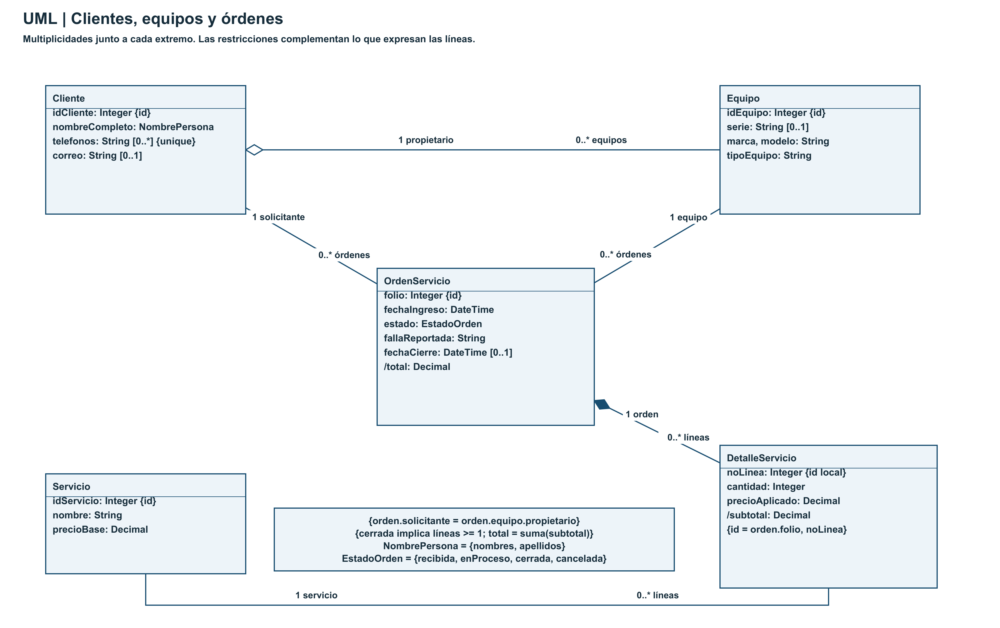
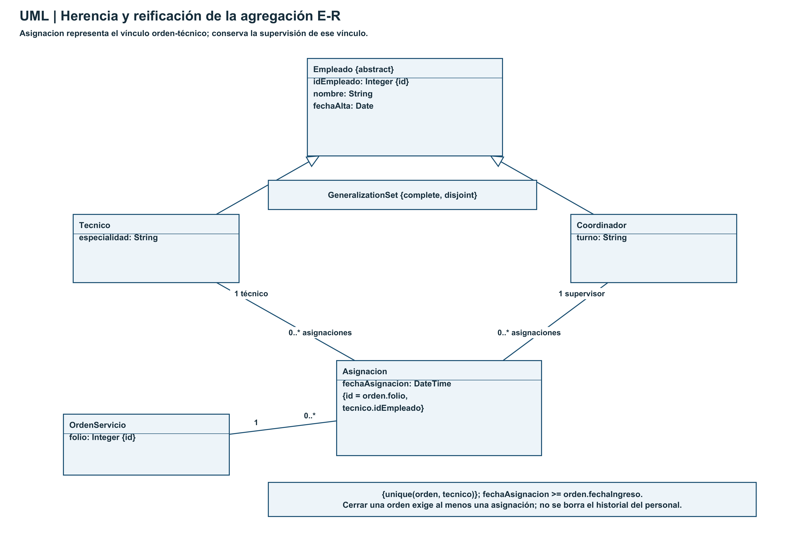

# Tarea 2.2: Transición del modelo E-R a UML

- **Institución:** Instituto Tecnológico Superior de Monclova (TecNM Campus Monclova)  
- **Alumno:** Orlando Martínez Villarreal (Matrícula: I24050386)  
- **Docente:** Rubén Miguel Riojas  
- **Materia:** Fundamentos de Bases de Datos  
- **Semestre:** 5  
- **Unidad:** 2 – Diseño de Bases de Datos con el Modelo E-R  
- **Competencia específica:** Conoce y aplica el modelo E-R para el diseño conceptual de bases de datos con el fin de organizar la información y atender necesidades del entorno.

---

## 📦 Entregables de la Actividad

- 📑 **Documento en PDF** · [Tarea2.2.pdf](./Tarea2.2.pdf)
- 🖼️ **Clases de dominio** · [PNG](./clases_dominio.png)
- 🖼️ **Clases de personal y asignaciones** · [PNG](./clases_personal.png)
- 🎥 **Video explicativo** · Grabación y publicación pendientes. [Guion y pendientes](./TODO.md).

---

## 1. Objetivo de la actividad

Transformar el modelo conceptual de TecSoporte Monclova de la [Tarea 2.1](../Tarea2.1/README.md) en un diagrama de clases UML que conserve identidad, atributos, multiplicidades y reglas de negocio. El caso es académico; no se dispone de entrevistas ni datos operativos de una empresa.

La fuente normativa para las asociaciones, multiplicidades y generalizaciones es UML 2.5.1 de Object Management Group (2017). Las marcas {id} e {id local} se utilizan como convenciones documentales del modelo, no como estereotipos oficiales que implementen claves SQL.

## 2. Método de transformación

1. Crear una clase por entidad fuerte: Cliente, Equipo, OrdenServicio, Servicio y Empleado.
2. Convertir DetalleServicio en una clase subordinada a OrdenServicio, conservando su identidad local.
3. Transformar los atributos simples en propiedades tipadas y el nombre compuesto en el tipo de valor NombrePersona.
4. Representar teléfono como una propiedad multivaluada con multiplicidad 0..* y unicidad; los importes derivados llevan el prefijo `/`.
5. Sustituir cada relación E-R por una asociación y colocar las multiplicidades en el extremo correspondiente de UML.
6. Convertir la especialización en herencia con Empleado abstracta y el conjunto de generalización {complete, disjoint}.
7. Reificar la relación ejecuta mediante Asignacion y asociarla con Coordinador. Las tres asociaciones conservan los participantes de la agregación E-R.
8. Añadir restricciones de estado, igualdad de propietario, importes y fechas que no se deducen de las asociaciones.

**Lectura de multiplicidades:** en E-R, Cliente (0,N) en solicita indica que un cliente participa en cero o muchas órdenes; en UML, ese 0..* se escribe junto a OrdenServicio. El 1 escrito junto a Cliente indica cuántos clientes corresponden a una orden. Copiar la etiqueta en el mismo lado sin reinterpretarla invertiría el significado.

## 3. Comparativa detallada E-R vs. UML

| Elemento del modelo E-R/E-RE | Representación UML en este caso | Coincidencia y diferencia |
| --- | --- | --- |
| Entidad Cliente | Clase Cliente | Ambas representan clientes; una instancia UML tiene identidad de objeto además del identificador del dominio. |
| Claves simples | Propiedades idCliente, idEquipo, folio, idServicio e idEmpleado con {id} | Se documenta unicidad; un diagrama UML no crea automáticamente restricciones en una base de datos. |
| Nombre compuesto | nombreCompleto: NombrePersona; tipo con nombres y apellidos | Preserva la agrupación semántica. NombrePersona es un valor, no una entidad con identidad propia. |
| Teléfono multivalorado | telefonos: String [0..*] {unique} | Se conservan cantidad y unicidad; el tipo String permite prefijos. |
| subtotal y total derivados | /subtotal: Decimal y /total: Decimal | La barra indica derivación; las fórmulas se expresan como restricciones. |
| Entidad débil DetalleServicio | Clase DetalleServicio con composición desde OrdenServicio | Cada línea pertenece a una orden y su identidad completa incluye folio y noLinea. |
| Relación posee | Agregación compartida Cliente-Equipo | El cliente agrupa equipos que mantienen identidad propia; el rombo blanco está en Cliente. |
| Relaciones solicita, recibe y refiere | Asociaciones simples | Se preservan participantes y multiplicidades sin añadir dependencias de ciclo de vida innecesarias. |
| Relación identificadora contiene | Composición OrdenServicio-DetalleServicio | Rombo negro junto a OrdenServicio; una línea no se comparte entre dos órdenes. |
| Jerarquía Empleado/Técnico/Coordinador | Generalización con triángulo hueco hacia Empleado | Hereda identidad y propiedades. {complete, disjoint} conserva totalidad y exclusión. |
| Relación N:M ejecuta con fechaAsignacion | Clase reificada Asignacion con dos asociaciones obligatorias | Cada Asignacion tiene una orden y un técnico; cada uno puede intervenir en muchas asignaciones. |
| Agregación E-R supervisada | Asociación Asignacion-Coordinador | Conserva que se supervisa una pareja orden-técnico específica. No se convierte mecánicamente en rombo blanco. |
| Cardinalidades y participación | Multiplicidades 0..*, 1 y restricciones condicionales | El mínimo cero conserva participación parcial y el uno conserva la participación obligatoria de cada instancia relacionada. |

## 4. Clases y propiedades

| Clase o tipo | Propiedades propias | Identidad y restricciones |
| --- | --- | --- |
| Cliente | idCliente: Integer; nombreCompleto: NombrePersona; telefonos: String [0..*]; correo: String [0..1] | idCliente positivo y único; teléfonos sin repetición. |
| NombrePersona (tipo de valor) | nombres: String; apellidos: String | Componentes no vacíos; igualdad por valor, sin identificador persistente propio. |
| Equipo | idEquipo: Integer; serie: String [0..1]; marca, modelo, tipoEquipo: String | Un propietario; serie no se supone única. |
| OrdenServicio | folio: Integer; fechaIngreso: DateTime; fallaReportada: String; estado: EstadoOrden; fechaCierre: DateTime [0..1]; /total: Decimal | folio positivo y único; solicitante debe ser el propietario del equipo. |
| EstadoOrden (enumeración) | recibida; enProceso; cerrada; cancelada | La presencia de fechaCierre equivale al estado cerrada. |
| Servicio | idServicio: Integer; nombre: String; precioBase: Decimal | Identificador único y precio no negativo. |
| DetalleServicio | noLinea: Integer; cantidad: Integer; precioAplicado: Decimal; /subtotal: Decimal | Identidad (orden.folio, noLinea); cantidad y noLinea positivos. |
| Empleado (abstracta) | idEmpleado: Integer; nombre: String; fechaAlta: Date | No se instancia directamente; idEmpleado se comparte con el subtipo. |
| Tecnico | especialidad: String | Hereda las tres propiedades de Empleado. |
| Coordinador | turno: String | Hereda las tres propiedades de Empleado. |
| Asignacion | fechaAsignacion: DateTime | Identidad (orden.folio, tecnico.idEmpleado); orden, técnico y supervisor obligatorios. |

No se añaden métodos de aplicación porque la actividad solicita correspondencia conceptual. Operaciones como cerrarOrden o calcularTotal podrían añadirse al diseñar los servicios de negocio, con validación de las mismas invariantes.

## 5. Asociaciones y multiplicidades

| Asociación | Multiplicidad junto a la primera clase | Multiplicidad junto a la segunda clase | Significado |
| --- | --- | --- | --- |
| Cliente - Equipo | Cliente: 1 | Equipo: 0..* | Cada equipo tiene un cliente; un cliente agrupa varios equipos. |
| Cliente - OrdenServicio | Cliente: 1 | OrdenServicio: 0..* | Una orden tiene un solicitante; un cliente puede solicitar muchas órdenes. |
| Equipo - OrdenServicio | Equipo: 1 | OrdenServicio: 0..* | Una orden atiende un equipo; el equipo puede tener varias visitas. |
| OrdenServicio - DetalleServicio | OrdenServicio: 1 | DetalleServicio: 0..* | Composición con máximo un propietario por detalle; cierre exige al menos una línea. |
| Servicio - DetalleServicio | Servicio: 1 | DetalleServicio: 0..* | El catálogo es independiente de cada línea. |
| OrdenServicio - Asignacion | OrdenServicio: 1 | Asignacion: 0..* | Toda asignación corresponde a una orden. |
| Tecnico - Asignacion | Tecnico: 1 | Asignacion: 0..* | Toda asignación designa un técnico. |
| Coordinador - Asignacion | Coordinador: 1 | Asignacion: 0..* | Toda asignación tiene un supervisor. |

## 6. Diagramas de clases

Las dos vistas pertenecen al mismo modelo; OrdenServicio aparece en ambas para conectar el dominio con el personal. Las etiquetas de asociaciones expresan de manera explícita multiplicidad y rol de ambos extremos; por ejemplo, «1 orden / 0..* líneas» fija un único propietario por línea. Las propiedades sin multiplicidad explícita son obligatorias [1].

### Asociación, agregación y composición

**Asociación simple.** OrdenServicio se asocia con Cliente y Equipo, sin incorporarlos como partes que desaparezcan con la orden. Servicio se asocia con los detalles y permanece en el catálogo aunque una línea se elimine de una orden abierta.

**Agregación compartida.** Cliente agrega Equipo con rombo blanco porque representa el conjunto de equipos del propietario, conservando su identidad. La multiplicidad fija un solo propietario en este caso; el rombo blanco por sí solo no impone exclusividad ni eliminación en cascada. Es una decisión de lectura del dominio, y podría sustituirse por una asociación simple sin perder la regla de propietario.

**Composición.** OrdenServicio compone sus detalles con rombo negro. Un detalle tiene un solo contenedor y no existe de forma independiente. La política del negocio impide borrar órdenes cerradas; en un borrador eliminable, eliminar la orden también elimina sus detalles. Composición no significa que toda orden deba tener detalles desde el momento de su creación: se admite 0..* y el cierre exige un mínimo de uno.

**Herencia.** Tecnico y Coordinador heredan de Empleado. El triángulo apunta al supertipo. Empleado abstracta evita instancias directas y el conjunto {complete, disjoint} documenta cobertura total y pertenencia exclusiva.

### Agregación E-R y clase reificada

La agregación E-R de la Tarea 2.1 trata como una unidad el hecho «un técnico ejecuta una orden». En UML se representa mediante Asignacion, conectada con una orden, un técnico y un coordinador. Así se puede almacenar fechaAsignacion y señalar qué coordinador supervisa ese hecho.

Se elige una clase reificada ordinaria en lugar del símbolo de clase de asociación para mostrar las tres referencias sin ambigüedad. La restricción unique(orden, tecnico) evita asignaciones duplicadas y conserva la identidad de la relación binaria original. Si en el futuro se requirieran varios episodios de asignación para la misma pareja, sería necesario revisar esa identidad y la regla RB11.

## 7. Invariantes conservadas

Las siguientes condiciones se expresan en lenguaje formalizado de dominio; no son código OCL ejecutado.

| Restricción | Expresión o criterio |
| --- | --- |
| Propietario y solicitante | orden.solicitante = orden.equipo.propietario. |
| Identidad local | No existen dos detalles con el mismo par (orden.folio, noLinea). |
| Total y subtotal | detalle.subtotal = cantidad × precioAplicado; orden.total = suma de subtotales, cero para colección vacía. |
| Cierre válido | estado = cerrada implica detalles.size >= 1 y asignaciones.size >= 1. |
| Fecha de cierre | fechaCierre está presente si y solo si estado = cerrada; cuando existe, fechaCierre >= fechaIngreso. |
| Fecha de asignación | fechaAsignacion >= orden.fechaIngreso y fechaAsignacion >= tecnico.fechaAlta. |
| Asignación única | No se repite (orden.folio, tecnico.idEmpleado); cada asignación tiene exactamente un coordinador. |
| Especialización | Todo Empleado pertenece exactamente a uno de {Tecnico, Coordinador}. |
| Precios | precioBase y precioAplicado >= 0; el precio de catálogo no modifica el precio histórico de la línea. |

## 8. Trazabilidad y validación de la conversión

| Reglas de Tarea 2.1 | Evidencia en UML | Escenario de comprobación |
| --- | --- | --- |
| RB01-RB02 | Cliente y Equipo; NombrePersona; telefonos [0..*]; propietario 1 | C1 puede registrar dos teléfonos y dos equipos; E1 sin propietario se rechaza. |
| RB03-RB04 | Asociaciones solicita y recibe, más invariante de propietario | O1 de E1 propiedad de C1 no puede ser solicitada por C2. |
| RB05-RB07 | DetalleServicio por composición; noLinea local; asociación a Servicio | Línea 1 en O1 y O2 es válida; dos líneas 1 en O1 no. |
| RB08-RB09 | Dominios decimales y propiedades derivadas | 2 × 150.00 + 1 × 300.00 produce total 600.00, igual que en E-R. |
| RB10 | Empleado abstracta, herencia y {complete, disjoint} | Se rechaza una instancia que sea técnico y coordinador simultáneamente. |
| RB11-RB12 | Asignacion con tres asociaciones de multiplicidad 1 y unicidad de pareja | O1/T1 y O1/T2 pueden tener supervisores distintos; ninguna puede quedar sin coordinador. |
| RB06 y RB13 | Invariantes de cierre y fechas | Cerrar sin asignaciones o registrar fechaCierre anterior al ingreso se rechaza. |
| RB14 | Persistencia del historial y precioAplicado propio de DetalleServicio | Una actualización de precioBase no modifica el importe de una orden previa. |

Esta verificación compara significados y ejemplos; no equivale a ejecutar código ni a probar un SGBD. El modelo conserva las ocho entidades de la tarea anterior y añade una clase de reificación. NombrePersona y EstadoOrden son tipos auxiliares, no nuevas entidades del negocio.

## 9. Coincidencias y utilidad para desarrollo orientado a objetos

Ambos modelos describen la misma realidad, distinguen identidad y expresan restricciones entre participantes. E-R se concentra en la estructura de datos persistentes; UML permite además incorporar comportamiento, visibilidad, interfaces y colaboración entre objetos. En esta actividad se utiliza la parte estructural de UML para que la comparación sea directa.

Una implementación orientada a objetos puede representar los teléfonos mediante una colección y el nombre mediante un objeto de valor. Las líneas pueden mantenerse dentro de una colección perteneciente a OrdenServicio y las asignaciones mediante referencias tipadas. Los invariantes deben comprobarse al modificar el estado; dibujar una composición o una generalización no configura automáticamente un ORM ni el esquema SQL.

La herencia exige elegir más adelante una estrategia de persistencia, como una tabla por jerarquía o una tabla por clase. Los importes deben usar un tipo decimal monetario, y no un punto flotante binario. Las asociaciones bidireccionales requieren mantener consistentes ambos lados si se materializan como colecciones en memoria.

## 10. Conclusiones

La conversión preserva las reglas del taller cuando se interpretan correctamente los extremos de multiplicidad y se documentan las condiciones que dependen del estado. La composición conserva la subordinación de los detalles; la herencia conserva la clasificación del personal; Asignacion permite conservar la supervisión de la relación agregada. La correspondencia requiere decisiones semánticas y no se limita a sustituir rectángulos por clases.

El resultado ofrece una base coherente para diseñar objetos y un esquema relacional posterior. Su aplicación real requiere validar los supuestos del caso y después implementar controles de integridad y pruebas de ejecución.

## 11. Referencias Bibliográficas (Formato APA 7ma Edición)

- Object Management Group. (2017). *OMG Unified Modeling Language (OMG UML), version 2.5.1*. https://www.omg.org/spec/UML/2.5.1/
- Silberschatz, A., Korth, H. F., & Sudarshan, S. (2020). *Database system concepts* (7.ª ed.). McGraw-Hill Education. Material de apoyo: https://www.db-book.com/slides-dir/PDF-dir/ch6.pdf
- JGraph Ltd. (s. f.). *Save a diagram in various formats*. Recuperado el 18 de noviembre de 2026, de https://www.drawio.com/docs/manual/editor/save-file-formats/
