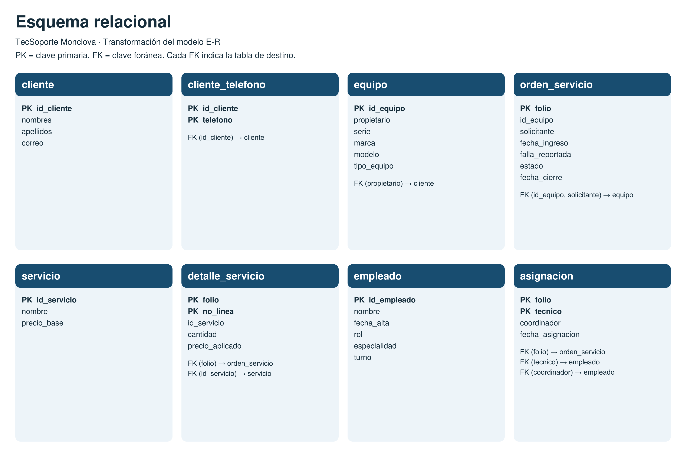

# Tarea 3.1: Transformación del Modelo E-R a Esquema Relacional

- **Institución:** TecNM Campus Monclova (ITSM)  
- **Alumno:** Orlando Martínez Villarreal (I24050386)  
- **Docente:** Rubén Miguel Riojas  
- **Materia:** Fundamentos de Bases de Datos  
- **Semestre:** 5  
- **Unidad:** 3 – Modelo relacional

---

## 📦 Entregables de la Actividad

- 📑 **Reporte técnico** · [Tarea3.1.pdf](./Tarea3.1.pdf)
- 🖼️ **Diagrama** · [esquema_relacional.png](./esquema_relacional.png)
- 🎥 **Video explicativo** · [Guion y pendientes](./TODO.md).

---

## 1. Contexto y conceptos formales

TecSoporte Monclova es un caso académico de un taller que registra equipos, órdenes, servicios y personal. Una **relación** es un conjunto de tuplas con los mismos atributos. Una **tupla** representa una ocurrencia. Un **atributo** identifica una propiedad y su **dominio** determina los valores admisibles. Por ejemplo, la relación EQUIPO admite un entero positivo como id_equipo y una cadena opcional como serie.

La integridad de entidad requiere una clave primaria única y obligatoria. La integridad referencial exige que cada clave foránea presente apunte a una clave válida. La integridad de dominio restringe tipos, nulabilidad y valores, como cantidad > 0 o precio_aplicado ≥ 0.

## 2. Formulación relacional

| Relación y atributos | Clave primaria | Claves foráneas |
| --- | --- | --- |
| CLIENTE(id_cliente, nombres, apellidos, correo) | id_cliente | — |
| CLIENTE_TELEFONO(id_cliente, telefono) | id_cliente, telefono | id_cliente → CLIENTE |
| EQUIPO(id_equipo, propietario, serie, marca, modelo, tipo_equipo) | id_equipo | propietario → CLIENTE |
| ORDEN_SERVICIO(folio, id_equipo, solicitante, fecha_ingreso, falla_reportada, estado, fecha_cierre) | folio | (id_equipo, solicitante) → EQUIPO(id_equipo, propietario) |
| SERVICIO(id_servicio, nombre, precio_base) | id_servicio | — |
| DETALLE_SERVICIO(folio, no_linea, id_servicio, cantidad, precio_aplicado) | folio, no_linea | folio → ORDEN_SERVICIO; id_servicio → SERVICIO |
| EMPLEADO(id_empleado, nombre, fecha_alta, rol, especialidad, turno) | id_empleado | — |
| ASIGNACION(folio, tecnico, coordinador, fecha_asignacion) | folio, tecnico | folio → ORDEN_SERVICIO; tecnico y coordinador → EMPLEADO |

Las parejas (id_equipo, propietario) e (id_empleado, rol) son superclaves declaradas UNIQUE para servir de destino de referencias compuestas. Las columnas físicas rol_tecnico y rol_coordinador son constantes de control, respectivamente T y C.

## 3. Reglas de conversión

- **1:N.** La clave pasa al lado N. EQUIPO referencia a CLIENTE, DETALLE_SERVICIO al catálogo y ORDEN_SERVICIO al equipo. La clave compuesta de la orden obliga a que el solicitante coincida con el propietario.
- **1:1.** Una FK con UNIQUE preserva el máximo uno. Si ambos lados son obligatorios y comparten ciclo de vida, pueden fusionarse. El caso carece de relaciones binarias 1:1 entre entidades independientes. Cada perfil de empleado queda representado por un único registro de la jerarquía.
- **N:M.** ASIGNACION materializa ejecuta con la clave de la orden y el técnico. El coordinador supervisa cada asignación y la fecha es un atributo del vínculo.
- **Entidad débil y atributo multivalorado.** DETALLE_SERVICIO usa el folio más la clave parcial no_linea. CLIENTE_TELEFONO separa los teléfonos en filas y evita duplicar el mismo teléfono de un cliente.
- **Jerarquía total y disjunta.** EMPLEADO registra un rol obligatorio. T exige especialidad y C exige turno, con el otro atributo de subtipo vacío.
- **Atributos derivados.** El subtotal resulta de cantidad × precio_aplicado. El total suma los subtotales de la orden. El precio aplicado conserva el dato histórico frente a cambios de catálogo.

## 4. Dependencias y normalización

En CLIENTE, EQUIPO, ORDEN_SERVICIO, SERVICIO y EMPLEADO, la clave determina los atributos propios. En DETALLE_SERVICIO, la pareja (folio, no_linea) determina servicio, cantidad y precio aplicado. En ASIGNACION, (folio, tecnico) determina fecha y coordinador. Los teléfonos atómicos y los detalles independientes evitan grupos repetidos y dependencias parciales.

La copia de solicitante en ORDEN_SERVICIO expresa la relación conceptual solicita. Bajo la regla del propietario, se cumple id_equipo → solicitante. Esto introduce una dependencia transitiva en esa tabla, controlada por la FK compuesta y la inmutabilidad del propietario. Una formulación estricta en 3FN podría derivar solicitante con una vista a partir de EQUIPO. Las columnas constantes de rol son auxiliares del control referencial físico.

## 5. Conclusión

La transformación conserva identidad, participación e historial. Las claves compuestas resuelven la identidad local del detalle y vinculan el solicitante con el equipo correcto. Las reglas que comparan fechas entre tablas o requieren hijos al cerrar necesitan validación adicional.

## 6. Referencias Bibliográficas

- Silberschatz, A., Korth, H. F., & Sudarshan, S. (2020). *Database system concepts* (7.ª ed.). McGraw-Hill.
