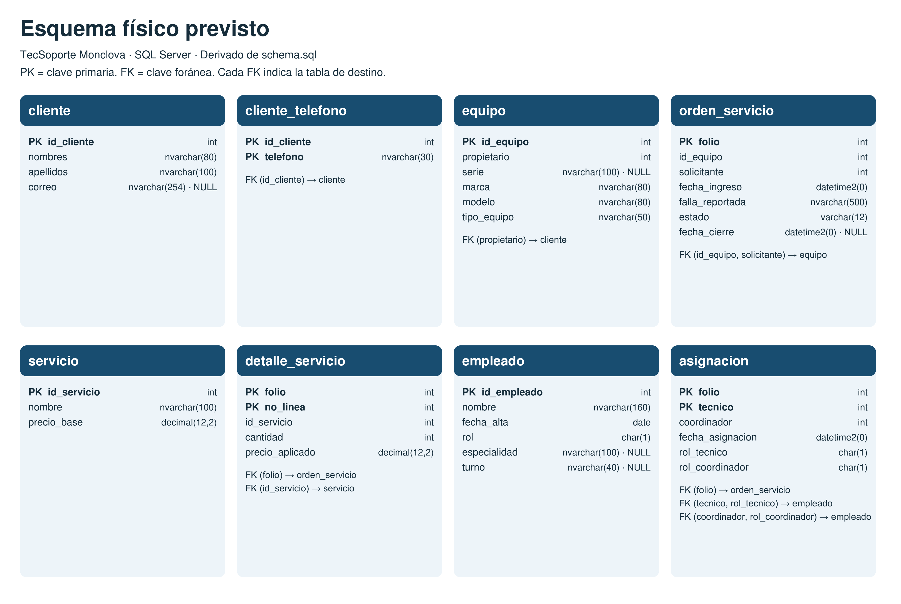
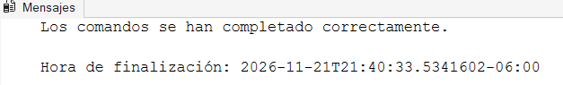
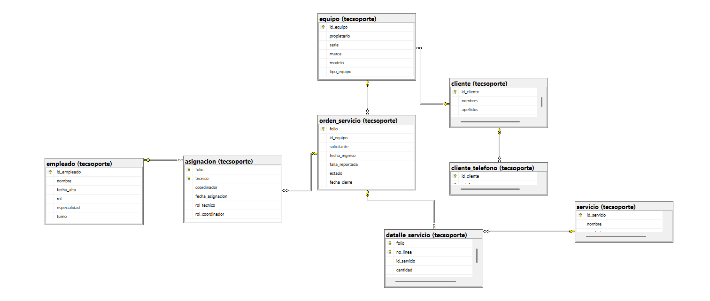
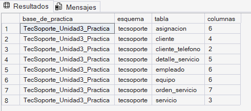
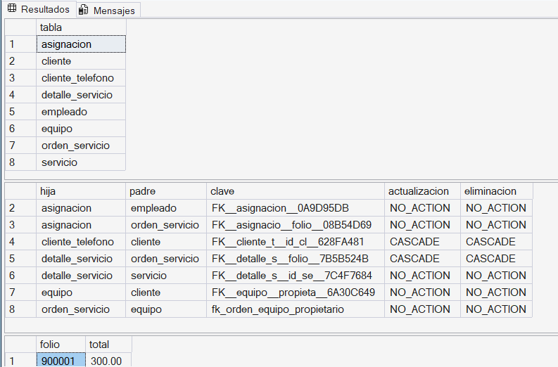
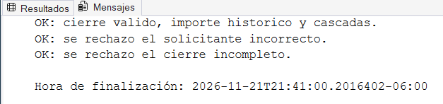

# Tarea 3.2: Generación del Esquema Físico y Script LDD

- **Institución:** TecNM Campus Monclova (ITSM)  
- **Alumno:** Orlando Martínez Villarreal (I24050386)  
- **Docente:** Rubén Miguel Riojas  
- **Materia:** Fundamentos de Bases de Datos  
- **Semestre:** 5  
- **Unidad:** 3 – Modelo relacional

---

## 📦 Entregables de la Actividad

- 📑 **Reporte técnico** · [Tarea3.2.pdf](./Tarea3.2.pdf)
- 🖼️ **Diagrama** · [esquema_fisico.png](./esquema_fisico.png)
- **Scripts SQL** · [DDL](./schema.sql) | [Verificación](./verificar.sql).
- 🎥 **Video Explicativo en YouTube:** [Video en YouTube]()

---

## 1. Implementación

El esquema tecsoporte usa SQL Server 2017 o posterior. Los identificadores son int positivos. Los textos con acentos usan nvarchar. Los importes se guardan como decimal(12,2), las fechas de eventos como datetime2(0) y la fecha de alta como date. Las columnas de estado y rol tienen intercalación binaria para distinguir los valores definidos.

## 2. Diccionario de datos

Campos obligatorios salvo indicación expresa. PK indica clave primaria, FK indica clave foránea, UQ indica unicidad.

| Tabla | Columnas y tipos | Reglas principales |
| --- | --- | --- |
| cliente | id_cliente int; nombres nvarchar(80); apellidos nvarchar(100); correo nvarchar(254) opcional | PK id_cliente. Nombres y apellidos requeridos. |
| cliente_telefono | id_cliente int; telefono nvarchar(30) | PK compuesta. FK a cliente con cascada. |
| equipo | id_equipo int; propietario int; serie nvarchar(100) opcional; marca y modelo nvarchar(80); tipo_equipo nvarchar(50) | PK id_equipo. FK propietario. UQ (id_equipo, propietario). |
| orden_servicio | folio int; id_equipo y solicitante int; fecha_ingreso y fecha_cierre datetime2(0), cierre opcional; falla_reportada nvarchar(500); estado varchar(12) | PK folio. FK compuesta a equipo. El cierre exige fecha válida, detalle y asignación. |
| servicio | id_servicio int; nombre nvarchar(100); precio_base decimal(12,2) | PK id_servicio. Precio no negativo. |
| detalle_servicio | folio, no_linea, id_servicio y cantidad int; precio_aplicado decimal(12,2) | PK (folio, no_linea). FK a orden y servicio. Cantidad positiva y precio no negativo. |
| empleado | id_empleado int; nombre nvarchar(160); fecha_alta date; rol char(1); especialidad nvarchar(100) y turno nvarchar(40), opcionales según el rol | PK id_empleado. UQ (id_empleado, rol). Especialización total y disjunta. |
| asignacion | folio, tecnico y coordinador int; fecha_asignacion datetime2(0); rol_tecnico y rol_coordinador char(1) | PK (folio, tecnico). FK a orden y dos FK compuestas a empleado. Roles fijos T y C. |

## 3. Integridad y acciones referenciales

- El borrado o cambio de clave de un cliente sin equipos se propaga a sus teléfonos. Los detalles siguen a la orden por cascada. Una orden cerrada queda protegida por el desencadenador, y una orden que conserva asignaciones queda protegida por su FK.
- Las referencias de equipo, catálogo y personal usan NO ACTION para proteger filas referenciadas. La validación de propietario impide transferir equipos mediante UPDATE.
- Las vistas de importes calculan subtotal y total. La vista de incidencias detecta cierres incompletos y fechas de asignación anteriores al ingreso o al alta. Los desencadenadores rechazan cambios que introducen esas incidencias.

## 4. Reproducción y evidencias

1. Crear o seleccionar una base vacía de prácticas. Ejecutar schema.sql con SQLCMD o en SSMS. El DDL crea ocho tablas, tres vistas y cinco desencadenadores.
2. Ejecutar verificar.sql. Consulta tablas y claves foráneas del catálogo y prueba un cierre válido, el importe histórico, la cascada de teléfonos y el rechazo de un propietario incorrecto y un cierre incompleto. El bloque de datos válidos usa ROLLBACK.
3. En SSMS, abrir **Diagramas de base de datos** y agregar las ocho tablas del esquema para generar el diagrama físico.

La práctica se ejecutó en SQL Server Management Studio (SSMS), en la base TecSoporte_Unidad3_Practica. El anexo documenta la creación del esquema, el diagrama T32, las ocho tablas, las acciones referenciales, el importe histórico y las pruebas de integridad.

### Evidencias en SSMS

**Figura 1. Ejecución del esquema.** SSMS confirma que los comandos de creación se completaron correctamente.

**Figura 2. Diagrama físico T32.** Diagrama generado en SSMS a partir de las ocho tablas y sus relaciones en el esquema tecsoporte.

**Figura 3. Catálogo de tablas.** La consulta de catálogo identifica la base TecSoporte_Unidad3_Practica y las ocho tablas del esquema tecsoporte.

**Figura 4. Claves foráneas e importe histórico.** La cuadrícula muestra las acciones referenciales visibles y el folio 900001 con total de 300.00.

**Figura 5. Pruebas de integridad.** Los tres mensajes OK confirman el cierre válido, el importe histórico y las cascadas, además del rechazo del solicitante incorrecto y del cierre incompleto.

## 5. Conclusión

Las restricciones declarativas protegen claves, roles, propietario y dominios. Los desencadenadores completan las reglas de cierre y fechas que dependen de varias tablas. El script de verificación permite comprobar esos resultados desde una base de prácticas.

## 6. Referencias Bibliográficas

- Microsoft. (s. f.). *CREATE TABLE (Transact-SQL)*. https://learn.microsoft.com/en-us/sql/t-sql/statements/create-table-transact-sql
- Microsoft. (s. f.). *MSSQLSERVER_1785*. https://learn.microsoft.com/en-us/sql/relational-databases/errors-events/mssqlserver-1785-database-engine-error
