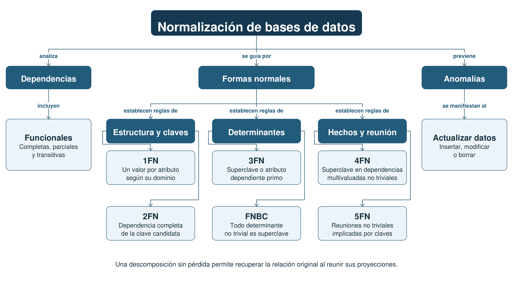

# Tarea 4.1: Fundamentos de dependencias y formas normales

- **Institución:** TecNM Campus Monclova (ITSM)
- **Alumno:** Orlando Martínez Villarreal (I24050386)
- **Docente:** Rubén Miguel Riojas
- **Materia:** Fundamentos de Bases de Datos
- **Semestre:** 5
- **Unidad:** 4 – Normalización de bases de datos

---

## 📦 Entregables de la Actividad

- 📑 **Reporte técnico** · [Tarea4.1.pdf](./Tarea4.1.pdf)
- 🖼️ **Recurso gráfico** · [mapa_conceptual.png](./mapa_conceptual.png)
- 🎥 **Video Explicativo en YouTube:** [Video en YouTube](https://youtu.be/Ny2MGKexArU)

---

## 1. Normalización y dependencias

La normalización analiza las restricciones semánticas de una relación para identificar redundancia y descomponerla. Una descomposición **sin pérdida** permite obtener la relación original al reunir las proyecciones. Preservar dependencias significa poder verificar las dependencias originales a partir de las proyectadas, sin reunir tablas. Ambas propiedades se evalúan por separado.

Una dependencia funcional X → Y indica que dos tuplas que coinciden en X deben coincidir en Y. Se deduce de las reglas del negocio. Una clave candidata es una superclave mínima y un atributo primo pertenece a alguna clave candidata. En LINEA(folio, no_linea, cantidad, fecha_ingreso), (folio, no_linea) → cantidad es completa si ningún subconjunto propio determina cantidad. En cambio, folio → fecha_ingreso es parcial respecto a la clave compuesta. En ORDEN(folio, id_equipo, propietario), folio → id_equipo e id_equipo → propietario producen una dependencia transitiva.

## 2. Anomalías en el taller

- **Inserción.** Si el catálogo existe solo dentro de las líneas de reparación, registrar un servicio nuevo exige inventar una orden o introducir valores vacíos improcedentes.
- **Modificación.** Si el precio base se copia a cada línea, actualizar solo algunas filas deja varios precios vigentes para un mismo servicio. El precio aplicado sí corresponde a cada línea y debe conservarse.
- **Borrado.** Al eliminar la última línea que menciona un servicio se pierde su ficha de catálogo si ambas están en la misma relación.

## 3. Mapa conceptual

## 4. Formas normales y ejemplos

- **1FN.** Cada posición contiene un valor del dominio definido. Una columna con varios teléfonos para una política que trata cada número como un dato independiente se transforma en CLIENTE_TELEFONO(id_cliente, telefono).
- **2FN.** En 1FN, cada atributo no primo debe depender completamente de todas las claves candidatas. Si la clave de una línea es (folio, no_linea), la fecha de ingreso depende solo de folio y se traslada a ORDEN.
- **3FN.** Para toda DF no trivial X → A, X es superclave o A es atributo primo. En ORDEN la dependencia id_equipo → propietario viola 3FN si se guarda propietario como solicitante, porque un equipo puede tener varias órdenes y propietario no es primo.
- **FNBC.** En toda DF no trivial, el determinante es superclave. En ASESORIA(alumno, tema, tutor), supón que (alumno, tema) → tutor y tutor → tema. Las claves candidatas son (alumno, tema) y (alumno, tutor). tutor → tema cumple 3FN porque tema es primo, pero incumple FNBC. Descomponer en TUTOR_TEMA y ALUMNO_TUTOR permite reunión sin pérdida, aunque la primera DF requiere una validación entre tablas.
- **4FN.** Toda dependencia multivaluada no trivial X ↠ Y exige que X sea superclave. Si teléfonos y correos alternativos de un cliente son independientes, almacenar sus combinaciones implica id_cliente ↠ telefono. Se separan ambos conjuntos en tablas distintas.
- **5FN.** Toda dependencia de reunión no trivial debe estar implicada por las claves candidatas. Si el taller define que una autorización (técnico, servicio, sede) existe exactamente cuando existen los tres pares compatibles, se puede almacenar cada par. Si se aprueban triples específicos, reunir los pares podría inventar autorizaciones.

## 5. Conclusión

La forma normal se comprueba con las reglas de negocio. Eliminar una DF parcial o transitiva reduce redundancia, y comprobar la reunión evita perder información o introducir combinaciones espurias.

## 📚 Referencias Bibliográficas

- Silberschatz, A., Korth, H. F., & Sudarshan, S. (2020). *Database system concepts* (7.ª ed., cap. 7). McGraw-Hill. https://www.db-book.com/
