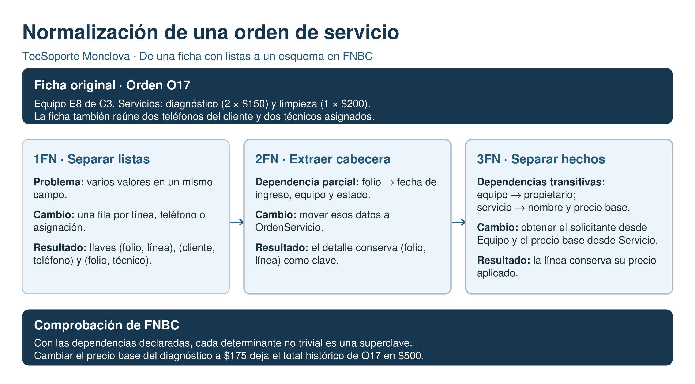

# Tarea 4.2: Normalización aplicada a TecSoporte Monclova

- **Institución:** TecNM Campus Monclova (ITSM)
- **Alumno:** Orlando Martínez Villarreal (I24050386)
- **Docente:** Rubén Miguel Riojas
- **Materia:** Fundamentos de Bases de Datos
- **Semestre:** 5
- **Unidad:** 4 – Normalización de bases de datos

---

## 📦 Entregables de la Actividad

- 📑 **Reporte técnico** · [Tarea4.2.pdf](./Tarea4.2.pdf)
- 🖼️ **Recurso gráfico** · [proceso_normalizacion.png](./proceso_normalizacion.png)
- **Script SQL** · [normalized_schema.sql](./normalized_schema.sql)
- 🎥 **Video explicativo** · [Guion y pendientes](./TODO.md)

---

## 1. Origen y reglas

Se continúa el caso de la Unidad 3. Para mostrar todas las fases se reconstruye una ficha desnormalizada de orden, con cabecera, una lista de servicios, una lista de técnicos y los teléfonos del cliente. El DDL de la Unidad 3 ya separaba esas listas, pero aún almacenaba solicitante y las constantes rol_tecnico y rol_coordinador. La regla del caso establece que el solicitante es el propietario registrado del equipo y que ese propietario no se transfiere.

Ejemplo de partida: O17, equipo E8 de C3, se registra el 18 de noviembre. Sus líneas son (1, diagnóstico, 2, 150.00) y (2, limpieza, 1, 200.00). Los técnicos T1 y T2 se asignan independientemente de las líneas y C3 tiene dos teléfonos. Cruzar las listas produciría ocho filas de combinaciones para una orden de dos líneas.

## 2. Descomposición paso a paso

### De la ficha a 1FN

Se separan LINEA_1FN(folio, no_linea, fecha_ingreso, id_equipo, solicitante, estado, id_servicio, nombre_servicio, precio_base, cantidad, precio_aplicado), CLIENTE_TELEFONO(id_cliente, telefono) y ASIGNACION(folio, tecnico, coordinador, fecha_asignacion). Las claves son, respectivamente, (folio, no_linea), (id_cliente, telefono) y (folio, tecnico). Se mantiene una cabecera incluso cuando no hay líneas. La separación impide multiplicar líneas al combinar hechos independientes.

### De 1FN a 2FN

folio → fecha_ingreso, id_equipo, solicitante, estado es parcial respecto de (folio, no_linea). Se extrae ORDEN_SERVICIO con clave folio. La línea conserva los atributos propios y temporalmente los datos de catálogo. La intersección folio es clave de la cabecera, por lo que la reunión binaria de las proyecciones de líneas es sin pérdida. Las órdenes sin líneas se consultan desde la cabecera o mediante LEFT JOIN.

### De 2FN a 3FN

- **Catálogo.** id_servicio → nombre_servicio, precio_base. Se extrae SERVICIO y se conserva su FK en DETALLE_SERVICIO. La intersección id_servicio es clave de SERVICIO. precio_aplicado sigue en la línea, pues depende de la pareja (folio, no_linea).
- **Propietario.** folio → id_equipo e id_equipo → solicitante bajo la regla del caso. Se elimina solicitante de ORDEN_SERVICIO y se recupera con EQUIPO.propietario en v_orden_solicitante. La FK obligatoria permite recuperar un solo propietario por orden y el desencadenador protege su inmutabilidad.
- **Personal.** Se eliminan las columnas constantes de rol de ASIGNACION. Dos FK apuntan a EMPLEADO. El rol se valida al registrar una asignación y al cambiar el rol del empleado. Cada empleado mantiene un subtipo obligatorio y exclusivo.

## 3. Validación de FNBC

Con las DF documentadas, los determinantes no triviales de CLIENTE, EQUIPO, ORDEN_SERVICIO, SERVICIO y EMPLEADO son sus claves simples. DETALLE_SERVICIO tiene (folio, no_linea) → id_servicio, cantidad, precio_aplicado y ASIGNACION tiene (folio, tecnico) → coordinador, fecha_asignacion. CLIENTE_TELEFONO tiene la clave (id_cliente, telefono) y carece de DF no triviales adicionales. Bajo estas reglas, las ocho tablas cumplen FNBC. Esta verificación se limita a las DF declaradas. El cierre, los roles y las fechas entre tablas requieren controles adicionales.

## 4. Anomalías corregidas

- Se puede insertar un servicio sin inventar una línea o una orden.
- Cambiar el precio base de diagnóstico a 175.00 solo modifica el catálogo. El total de O17 sigue siendo 500.00 a partir de los precios aplicados.
- Borrar una línea de una orden abierta conserva el catálogo. Las órdenes cerradas conservan sus detalles y asignaciones mínimos.
- Registrar la orden ya no requiere repetir un solicitante que podría discrepar del propietario de E8.

## 5. Implementación SQL Server

El archivo normalized_schema.sql crea el esquema tecsoporte_normalizado para una instalación de práctica. Incluye ocho tablas, cuatro vistas de consulta o auditoría y cinco desencadenadores. Se instala en una base seleccionada con SQL Server 2017 o posterior. Es una creación de esquema, sin migración de registros de la Unidad 3.

Para verificar en el motor, cargar O17 y sus líneas y comprobar un total de 500.00 antes y después de cambiar el precio base. Consultar v_orden_solicitante para comprobar C3. Intentar asignar un coordinador como técnico y cerrar una orden sin hijos para comprobar el rechazo. Restaurar los datos de práctica al terminar.

## 6. Conclusión

El esquema conserva el catálogo independiente, el historial de importes y la supervisión de cada asignación. La vista del solicitante elimina la dependencia transitiva que persistía en la Unidad 3.

## 📚 Referencias Bibliográficas

- Silberschatz, A., Korth, H. F., & Sudarshan, S. (2020). *Database system concepts* (7.ª ed., cap. 7). McGraw-Hill. https://www.db-book.com/
