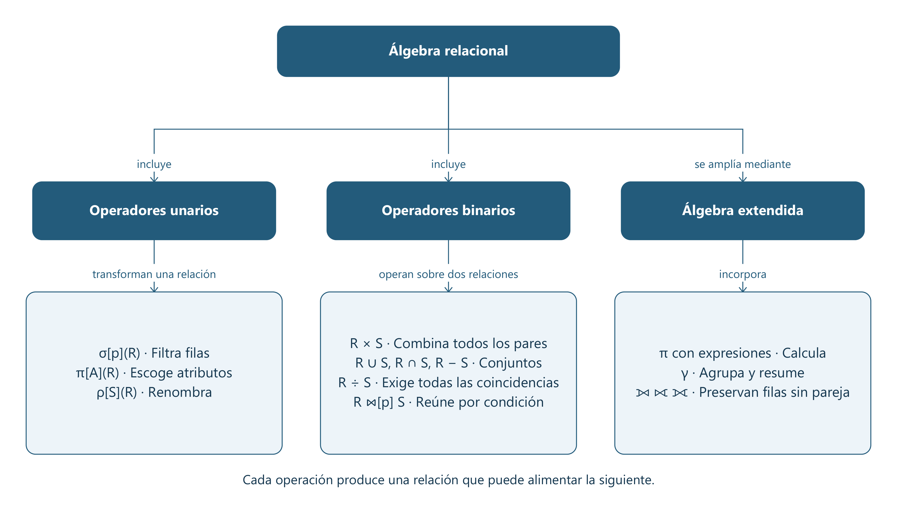

# Tarea 5.1: Operadores fundamentales y extendidos

- **Institución:** TecNM Campus Monclova (ITSM)
- **Alumno:** Orlando Martínez Villarreal (I24050386)
- **Docente:** Rubén Miguel Riojas
- **Materia:** Fundamentos de Bases de Datos
- **Semestre:** 5
- **Unidad:** 5 – Álgebra relacional

---

## 📦 Entregables de la Actividad

- 📑 **Reporte técnico** · [Tarea5.1.pdf](./Tarea5.1.pdf)
- 🖼️ **Mapa conceptual** · [mapa_algebra_relacional.png](./mapa_algebra_relacional.png)
- 🎥 **Video Explicativo en YouTube:** [Video en YouTube](https://youtu.be/npab0QQLM5s)
---

## 1. Modelo y notación

Una relación representa un conjunto de tuplas con un esquema de atributos y dominios. Las operaciones son cerradas: el resultado vuelve a ser una relación y puede alimentar otra operación. La proyección clásica elimina duplicados. Para unir, intersectar o restar se necesitan esquemas compatibles en atributos y dominios; cuando los nombres difieren se usa ρ para renombrar. El producto exige nombres distinguibles.

## 2. Operadores y ejemplos

| Operador | Notación formal | Significado y ejemplo |
| --- | --- | --- |
| Selección | σ[p](R) | Filtra filas. σ[estado = cerrada](Orden) conserva las órdenes cerradas. |
| Proyección | π[A](R) | Escoge columnas. π[id_equipo](Orden) devuelve los equipos presentes sin repetición. |
| Renombrado | ρ[S](R) | Nombra el resultado S o permite cambiar atributos, por ejemplo para comparar una tabla consigo misma. |
| Producto cartesiano | R × S | Combina cada fila de R con cada fila de S. Dos órdenes y tres técnicos producen seis pares. |
| Unión | R ∪ S | Elementos de al menos uno de los conjuntos: {8, 9} ∪ {9, 10} = {8, 9, 10}. |
| Intersección | R ∩ S | Elementos de ambos conjuntos: {8, 9} ∩ {9, 10} = {9}. |
| Diferencia | R − S | Filas de R ausentes en S: {8, 9} − {9, 10} = {8}. |
| División | R(X,Y) ÷ S(Y) | Devuelve valores X presentes en R que se relacionan con todo Y de S. Si R = {(17,1),(17,2),(19,1)} y S = {1,2}, el resultado es {17}. |
| Reunión theta | R ⋈[p] S | Selecciona pares del producto que satisfacen p. Orden ⋈[Orden.id_equipo = Equipo.id_equipo] Equipo vincula cada orden con su equipo. |
| Reunión natural | R ⋈ S | Igualdad en todos los nombres comunes, con una sola copia de cada atributo común. Si no hay nombres comunes, equivale al producto. |

## 3. Álgebra extendida

| Operador | Notación | Ejemplo |
| --- | --- | --- |
| Proyección generalizada | π[folio, cantidad × precio_aplicado → subtotal](Detalle) | Una línea con cantidad 2 y precio aplicado 150 produce subtotal 300. Si se agregan subtotales posteriormente conviene conservar también el número de línea para que dos líneas iguales no se fusionen. |
| Agrupación y agregación | γ[folio; SUM(subtotal) → total](Importes) | Los subtotales 300 y 200 de la misma orden suman 500. COUNT, AVG, MIN y MAX también se aplican por grupo. γ se usa aquí para el operador de agrupación G. |
| Reunión externa izquierda | R ⟕ S | Mantiene todas las filas izquierdas. Con Orden ⟕ Detalle, una orden sin líneas aparece con NULL en columnas de Detalle. |
| Reunión externa derecha | R ⟖ S | Mantiene todas las filas derechas. Con Detalle ⟖ Orden conserva también las órdenes vacías. |
| Reunión externa completa | R ⟗ S | Mantiene además las filas sin pareja de ambos lados. Si las listas del mismo atributo contienen equipos {8,9} y {9,10}, aparecen 8 y 10 además de la coincidencia 9. |

## 4. Conclusión

La composición separa el requisito en pasos comprobables. La selección determina qué filas interesan; la proyección determina qué atributos se entregan. La división expresa una exigencia universal, mientras que la reunión externa permite conservar entidades sin coincidencia.

## 📚 Referencias Bibliográficas

- Silberschatz, A., Korth, H. F., & Sudarshan, S. (2006). *Database System Concepts* (5.ª ed., cap. 2). McGraw-Hill. https://db-book.com/Previous-editions/db5/slide-dir/ch2.pdf
