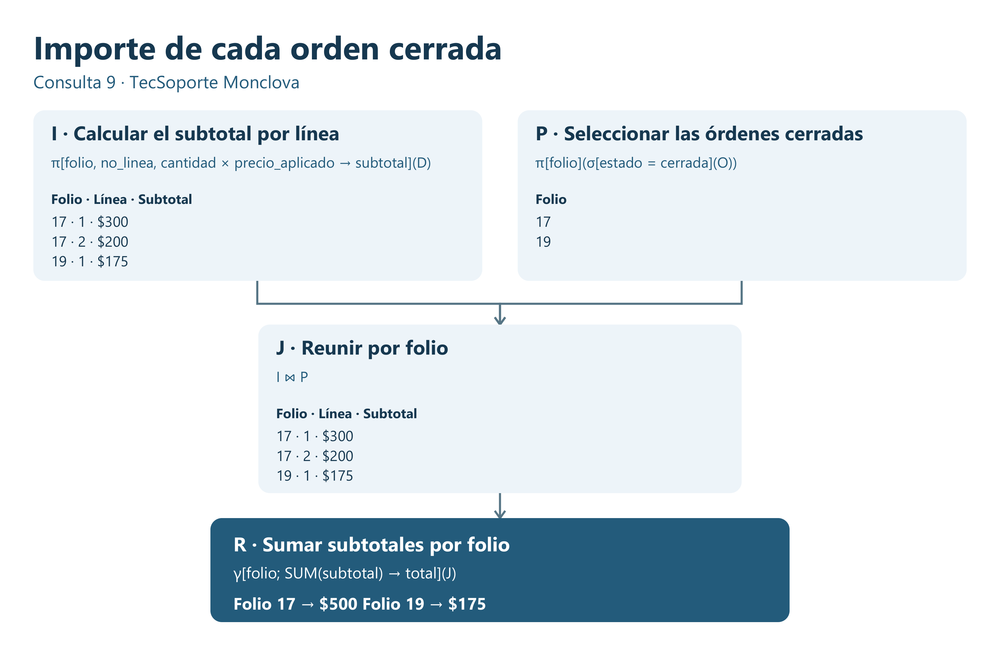
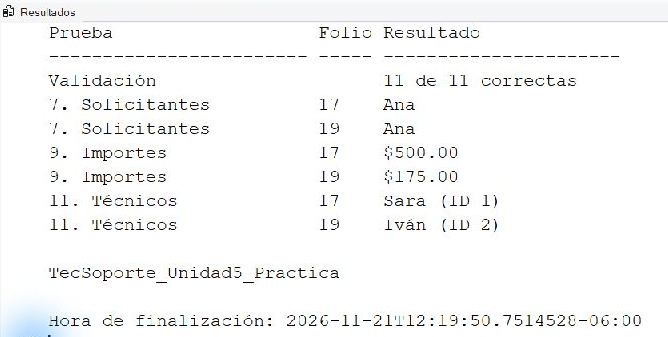

# Tarea 5.2: Consultas con álgebra relacional

- **Institución:** TecNM Campus Monclova (ITSM)
- **Alumno:** Orlando Martínez Villarreal (I24050386)
- **Docente:** Rubén Miguel Riojas
- **Materia:** Fundamentos de Bases de Datos
- **Semestre:** 5
- **Unidad:** 5 – Álgebra relacional

---

## 📦 Entregables de la Actividad

- 📑 **Reporte técnico** · [Tarea5.2.pdf](./Tarea5.2.pdf)
- 🖼️ **Flujo de la consulta 9** · [flujo_consulta.png](./flujo_consulta.png)
- **Scripts de práctica** · [consultas.sql](./consultas.sql)
- **SQL Server** · [Esquema y datos de práctica](./practica_sql_server.sql), [verificación](./verificar_sql_server.sql) y [captura PNG](./evidencia_ssms.png).
- 🎥 **Video Explicativo en YouTube:** [Video en YouTube]()

---

## Datos de trabajo

Las tablas siguientes son proyecciones del esquema normalizado de TecSoporte Monclova. Las columnas que no intervienen en las consultas se omiten. Los datos son ficticios. El propietario del equipo identifica al solicitante en este caso.

C = cliente, E = equipo, O = orden_servicio, S = servicio, D = detalle_servicio, M = empleado y A = asignacion. Los alias definidos dentro de cada consulta son locales. Los literales de texto se muestran sin comillas en las fórmulas. R identifica el resultado final.

### cliente

| id_cliente | nombres |
| --- | --- |
| 1 | Ana |
| 2 | Luis |
| 3 | Eva |

### equipo

| id_equipo | propietario |
| --- | --- |
| 8 | 1 |
| 9 | 2 |
| 10 | 1 |

### orden_servicio

| folio | id_equipo | estado |
| --- | --- | --- |
| 17 | 8 | cerrada |
| 18 | 9 | recibida |
| 19 | 8 | cerrada |

### servicio

| id_servicio | nombre | precio_base |
| --- | --- | --- |
| 1 | Diagnóstico | 175 |
| 2 | Limpieza | 200 |
| 3 | Respaldo | 300 |

### detalle_servicio

| folio | no_linea | id_servicio | cantidad | precio_aplicado |
| --- | --- | --- | --- | --- |
| 17 | 1 | 1 | 2 | 150 |
| 17 | 2 | 2 | 1 | 200 |
| 19 | 1 | 1 | 1 | 175 |

### empleado

| id_empleado | nombre | rol |
| --- | --- | --- |
| 1 | Sara | T |
| 2 | Iván | T |
| 3 | Elena | C |

### asignacion

| folio | tecnico | coordinador |
| --- | --- | --- |
| 17 | 1 | 3 |
| 19 | 2 | 3 |

## Catálogo de consultas

Se usa álgebra de conjuntos. El símbolo ⋈ sin predicado denota reunión natural por los atributos comunes. En la consulta 10, COUNT cuenta únicamente líneas con número presente, por lo que una orden vacía recibe cero.

## 1. Órdenes cerradas

Identificar folio y equipo de cada orden cerrada.

**C = σ[estado = cerrada](O)**

| folio | id_equipo | estado |
| --- | --- | --- |
| 17 | 8 | cerrada |
| 19 | 8 | cerrada |

**R = π[folio, id_equipo](C)**

| folio | id_equipo |
| --- | --- |
| 17 | 8 |
| 19 | 8 |

## 2. Equipos atendidos

Listar los equipos que aparecen en alguna orden, una sola vez.

**R = π[id_equipo](O)**

| id_equipo |
| --- |
| 8 |
| 9 |

## 3. Equipos sin órdenes

Identificar equipos registrados que nunca aparecen en una orden.

**E0 = π[id_equipo](E)**

| id_equipo |
| --- |
| 10 |
| 8 |
| 9 |

**O0 = π[id_equipo](O)**

| id_equipo |
| --- |
| 8 |
| 9 |

**R = E0 − O0**

| id_equipo |
| --- |
| 10 |

## 4. Clientes por dos criterios

Listar los identificadores de los clientes que poseen al menos un equipo o se llaman Eva.

**P = ρ[id_cliente ← propietario](π[propietario](E))**

| id_cliente |
| --- |
| 1 |
| 2 |

**V = π[id_cliente](σ[nombres = Eva](C))**

| id_cliente |
| --- |
| 3 |

**R = P ∪ V**

| id_cliente |
| --- |
| 1 |
| 2 |
| 3 |

## 5. Equipos con actividad y cierre

Listar los equipos que tienen alguna orden y además alguna orden cerrada.

**A0 = π[id_equipo](O)**

| id_equipo |
| --- |
| 8 |
| 9 |

**B0 = π[id_equipo](σ[estado = cerrada](O))**

| id_equipo |
| --- |
| 8 |

**R = A0 ∩ B0**

| id_equipo |
| --- |
| 8 |

## 6. Escenarios de asignación

Enumerar toda combinación posible de orden recibida y técnico habilitado por su rol.

**P = π[folio](σ[estado = recibida](O))**

| folio |
| --- |
| 18 |

**T = π[id_empleado](σ[rol = T](M))**

| id_empleado |
| --- |
| 1 |
| 2 |

**R = P × T**

| folio | id_empleado |
| --- | --- |
| 18 | 1 |
| 18 | 2 |

## 7. Solicitantes de órdenes cerradas

Mostrar quién solicitó cada orden cerrada según el propietario del equipo.

**P = π[folio, id_equipo](σ[estado = cerrada](O))**

| folio | id_equipo |
| --- | --- |
| 17 | 8 |
| 19 | 8 |

**Q = π[P.folio, P.id_equipo, E.propietario](P ⋈[P.id_equipo = E.id_equipo] E)**

| folio | id_equipo | propietario |
| --- | --- | --- |
| 17 | 8 | 1 |
| 19 | 8 | 1 |

**R = π[folio, nombres](Q ⋈[propietario = id_cliente] C)**

| folio | nombres |
| --- | --- |
| 17 | Ana |
| 19 | Ana |

## 8. Órdenes con todos los servicios objetivo

Encontrar órdenes que incluyan tanto diagnóstico como limpieza.

**P = π[folio, id_servicio](D)**

| folio | id_servicio |
| --- | --- |
| 17 | 1 |
| 17 | 2 |
| 19 | 1 |

**S0 = π[id_servicio](σ[id_servicio = 1 ∨ id_servicio = 2](S))**

| id_servicio |
| --- |
| 1 |
| 2 |

**R = P ÷ S0**

| folio |
| --- |
| 17 |

## 9. Importe de órdenes cerradas

Sumar el precio aplicado por cantidad en las órdenes cerradas.

**I = π[folio, no_linea, cantidad × precio_aplicado → subtotal](D)**

| folio | no_linea | subtotal |
| --- | --- | --- |
| 17 | 1 | 300 |
| 17 | 2 | 200 |
| 19 | 1 | 175 |

**P = π[folio](σ[estado = cerrada](O))**

| folio |
| --- |
| 17 |
| 19 |

**J = I ⋈ P**

| folio | no_linea | subtotal |
| --- | --- | --- |
| 17 | 1 | 300 |
| 17 | 2 | 200 |
| 19 | 1 | 175 |

**R = γ[folio; SUM(subtotal) → total](J)**

| folio | total |
| --- | --- |
| 17 | 500 |
| 19 | 175 |

## 10. Órdenes con o sin detalle

Mostrar cuántas líneas tiene cada orden, incluidas las órdenes vacías.

**I = π[folio, no_linea](D)**

| folio | no_linea |
| --- | --- |
| 17 | 1 |
| 17 | 2 |
| 19 | 1 |

**J = π[folio](O) ⟕ I**

| folio | no_linea |
| --- | --- |
| 17 | 1 |
| 17 | 2 |
| 18 | NULL |
| 19 | 1 |

**R = γ[folio; COUNT(no_linea) → lineas](J)**

| folio | lineas |
| --- | --- |
| 17 | 2 |
| 18 | 0 |
| 19 | 1 |

## 11. Técnicos de órdenes cerradas

Mostrar el identificador y el nombre de cada técnico asignado a una orden cerrada.

**P = π[folio](σ[estado = cerrada](O))**

| folio |
| --- |
| 17 |
| 19 |

**T = π[id_empleado, nombre](σ[rol = T](M))**

| id_empleado | nombre |
| --- | --- |
| 1 | Sara |
| 2 | Iván |

**J = π[folio, tecnico](P ⋈ A)**

| folio | tecnico |
| --- | --- |
| 17 | 1 |
| 19 | 2 |

**R = π[folio, tecnico, nombre](J ⋈[tecnico = id_empleado] T)**

| folio | tecnico | nombre |
| --- | --- | --- |
| 17 | 1 | Sara |
| 19 | 2 | Iván |

## Lectura visual de la consulta 9

El diagrama sigue las dos entradas de la consulta. La proyección generalizada calcula subtotales usando el precio aplicado, mientras la selección identifica los folios de órdenes cerradas. La reunión por folio entrega las líneas que se agrupan para calcular el total por orden.

## Validación y reproducción

El script validar.py compara los once resultados finales con sus valores esperados en SQLite en memoria. Las tablas intermedias del catálogo se cotejaron con las salidas de las consultas equivalentes. La simulación usa datos ficticios y tablas simplificadas del proyecto. Desde la raíz del repositorio, ejecuta `python Unidad5/Tarea5.2/validar.py`.

## Evidencia en SQL Server Management Studio

Se creó `TecSoporte_Unidad5_Practica` y se cargaron las ocho tablas del esquema normalizado con datos ficticios. La verificación en SQL Server comparó los resultados de las 11 consultas con los del catálogo, incluyendo el número de filas. La captura muestra el contador de validaciones y las salidas de las consultas 7, 9 y 11.

En la consulta 7, Ana figura como solicitante de los folios 17 y 19. En la consulta 9, los importes son 500.00 y 175.00 pesos. En la consulta 11, se identifican los técnicos Sara (1) e Iván (2).

Para reproducir la práctica en otra instancia, crea una base vacía denominada `TecSoporte_Unidad5_Practica`. Ejecuta una vez [practica_sql_server.sql](./practica_sql_server.sql) y después ejecuta [verificar_sql_server.sql](./verificar_sql_server.sql).

## 📚 Referencias Bibliográficas

- Silberschatz, A., Korth, H. F., & Sudarshan, S. (2006). *Database System Concepts* (5.ª ed., cap. 2). McGraw-Hill. https://db-book.com/Previous-editions/db5/slide-dir/ch2.pdf
