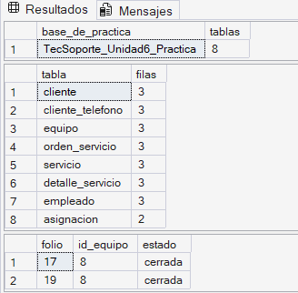
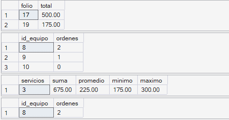
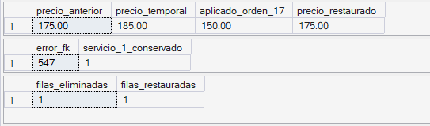
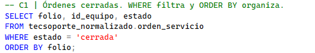
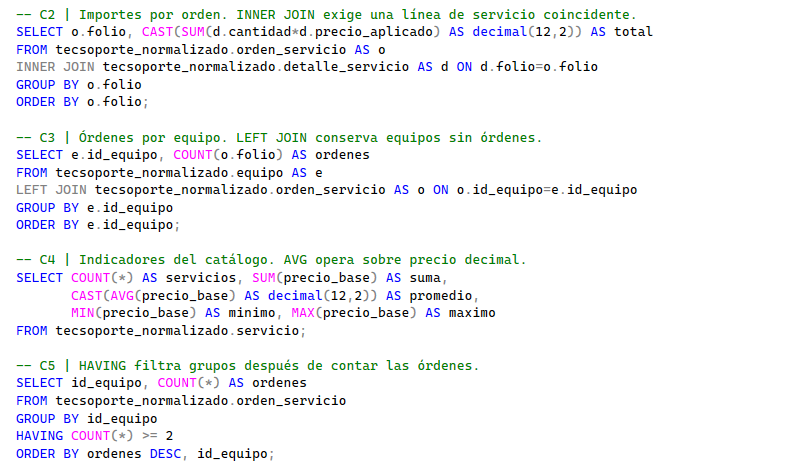
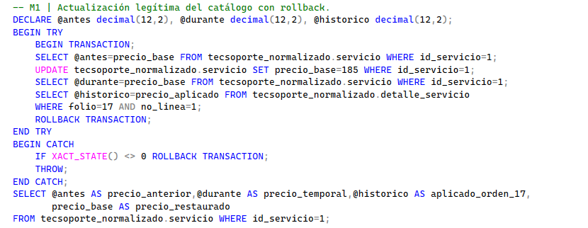
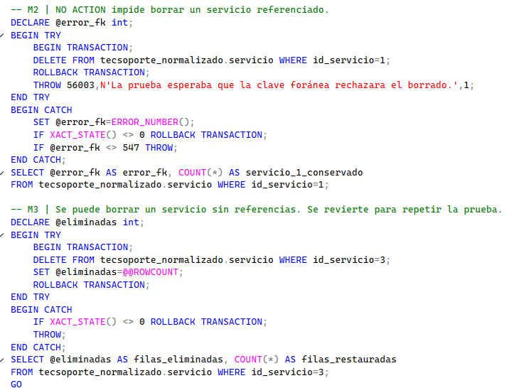

# Unidad 6: Introducción al lenguaje SQL

> **Tecnológico Nacional de México — Campus Monclova (ITSM)**  
> **Carrera:** Ingeniería en Sistemas Computacionales  
> **Materia:** Fundamentos de Bases de Datos  
> **Semestre:** 5° Semestre  
> **Docente:** Rubén Miguel Riojas  
> **Alumno:** Orlando Martínez Villarreal *(I24050386)*  
> **Competencia específica:** Aplica los comandos básicos del lenguaje SQL para la definición y manipulación de bases de datos.

---

## 📌 Presentación de la Unidad

La unidad implementa en SQL Server el modelo de TecSoporte Monclova. Los comandos de definición crean el esquema y sus restricciones. Los de manipulación permiten cargar datos, consultar las órdenes y ensayar cambios controlados. La práctica continúa el [trabajo con álgebra relacional de la Unidad 5](../Unidad5/README.md).

---

## 📂 Estructura del Repositorio de la Unidad

```plaintext
Unidad6/
├── README.md
├── Tarea6.1/
│   ├── README.md
│   └── Tarea6.1.pdf
└── Tarea6.2/
    ├── README.md
    ├── Tarea6.2.pdf
    ├── 01_schema_ddl.sql
    ├── 02_data_inserts.sql
    ├── 03_queries_dml.sql
    ├── 01_resultados_esquema_carga_c1.png
    ├── 02_resultados_consultas_c2_a_c5.png
    ├── 03_resultados_mantenimiento_m1_a_m3.png
    ├── 04_codigo_consulta_c1.png
    ├── 05_codigo_consultas_c2_a_c5.png
    ├── 06_codigo_actualizacion_m1.png
    └── 07_codigo_borrado_m2_y_m3.png
```

Consulta las [instrucciones de la unidad](./ACT.md).

---

## 📑 Resumen de Actividades

| Actividad | Tema Principal | Recursos Gráficos Clave | Documento Técnico | Documentación Detallada |
| :--- | :--- | :--- | :--- | :--- |
| **[Tarea 6.1](./Tarea6.1/README.md)** | Sintaxis y clasificación de sentencias SQL | — | 📄 [Tarea6.1.pdf](./Tarea6.1/Tarea6.1.pdf) | 📖 [README Tarea 6.1](./Tarea6.1/README.md)<br>[Tabla comparativa](./Tarea6.1/README.md#2-tabla-comparativa) |
| **[Tarea 6.2](./Tarea6.2/README.md)** | Esquema, carga, consultas y mantenimiento en SQL Server | [Capturas de SSMS (PNG)](#evidencias-de-la-tarea-62) | 📄 [Tarea6.2.pdf](./Tarea6.2/Tarea6.2.pdf) | 📖 [README Tarea 6.2](./Tarea6.2/README.md) |

---

## 1. 📘 Tarea 6.1: Sintaxis y clasificación de sentencias SQL

- **Ubicación** · [Tarea 6.1](./Tarea6.1/README.md)
- **Objetivo de la actividad.** Comparar las sentencias básicas de T-SQL y clasificarlas según su propósito.

### Contenidos Clave Abordados

El reporte compara ocho comandos de T-SQL y documenta su sintaxis, parámetros y restricciones. La clasificación establece qué sentencias se utilizan para definir la estructura y cuáles se aplican a los datos.

| Familia | Sentencias estudiadas | Propósito |
| --- | --- | --- |
| LDD · Definición de datos | `CREATE`, `ALTER`, `DROP`, `TRUNCATE` | Crear y modificar objetos, eliminar tablas o vaciar su contenido. |
| LMD · Manipulación de datos | `INSERT`, `UPDATE`, `DELETE`, `SELECT` | Cargar, modificar, eliminar y consultar registros. |

---

## 2. 📗 Tarea 6.2: Implementación del esquema, carga y consultas

- **Ubicación** · [Tarea 6.2](./Tarea6.2/README.md)
- **Objetivo de la actividad.** Implementar el esquema de TecSoporte Monclova en SQL Server y comprobar su funcionamiento con consultas y operaciones de mantenimiento.

### Contenidos Clave Abordados

1. **Creación y carga.** La práctica crea `TecSoporte_Unidad6_Practica` con **8 tablas y 23 registros ficticios**.
2. **Consultas.** Las cinco consultas muestran órdenes cerradas, importes, conteos por equipo e indicadores del catálogo.
3. **Mantenimiento.** Las tres pruebas muestran cómo `ROLLBACK` revierte cambios y cómo una clave foránea impide borrar un servicio referenciado.

### Reproducción de la Práctica

Conéctate a una instancia de SQL Server desde SQL Server Management Studio (SSMS) y ejecuta los scripts en este orden:

1. [01_schema_ddl.sql](./Tarea6.2/01_schema_ddl.sql) crea la base y su esquema.
2. [02_data_inserts.sql](./Tarea6.2/02_data_inserts.sql) carga los datos iniciales. Ejecútalo una sola vez en el esquema vacío.
3. [03_queries_dml.sql](./Tarea6.2/03_queries_dml.sql) ejecuta las cinco consultas y las tres pruebas de mantenimiento. Las pruebas revierten sus cambios al terminar.

### Evidencias de la Tarea 6.2

#### Resultados en SSMS

**Figura 1. Creación de la base, carga y consulta C1.** SSMS muestra las 8 tablas, los 23 registros de prueba y las órdenes cerradas de los folios 17 y 19.



**Figura 2. Resultados de las consultas C2 a C5.** Se observan los importes por orden, el conteo por equipo, los indicadores del catálogo y el equipo que cumple el filtro de HAVING.



**Figura 3. Resultados de las pruebas M1 a M3.** Las cuadrículas muestran el precio restaurado, el error 547 por la clave foránea y la fila recuperada con ROLLBACK.



#### Código T-SQL

**Figura 4. Código de la consulta C1.** WHERE selecciona las órdenes cerradas y ORDER BY las ordena por folio.



**Figura 5. Código de las consultas C2 a C5.** Las consultas combinan INNER JOIN, LEFT JOIN, funciones de agregación, GROUP BY y HAVING.



**Figura 6. Código de la actualización M1.** UPDATE cambia el precio base dentro de una transacción. ROLLBACK recupera el precio inicial.



**Figura 7. Código de las pruebas de borrado M2 y M3.** El primer bloque comprueba el rechazo por clave foránea. El segundo borra un servicio sin referencias y revierte el cambio.



---

## 🔄 Articulación Conceptual entre Tarea 6.1 y Tarea 6.2

La práctica aplica la clasificación de sentencias SQL al esquema y a los datos de TecSoporte Monclova.

| Familia estudiada en la Tarea 6.1 | Aplicación en la Tarea 6.2 |
| :--- | :--- |
| LDD | Crear la base, sus tablas y las restricciones de integridad. |
| LMD | Cargar registros, consultar órdenes y probar actualizaciones y eliminaciones. |

La consulta de totales traduce a SQL el cálculo que se formuló con reunión y agregación en la [Tarea 5.2](../Unidad5/Tarea5.2/README.md).

---

## 🛠️ Herramientas y Tecnologías Utilizadas

- **SQL Server y T-SQL.** Creación del esquema, carga de datos, consultas y pruebas de mantenimiento.
- **SQL Server Management Studio.** Ejecución de los scripts y captura del código y los resultados.
- **Documentación académica.** Reportes PDF, documentación en Markdown y evidencias en PNG.

---

## 📚 Referencias Bibliográficas (Formato APA 7ma Edición)

- Microsoft. (s. f.). *Referencia de Transact-SQL*. Microsoft Learn. https://learn.microsoft.com/en-us/sql/t-sql/language-reference
